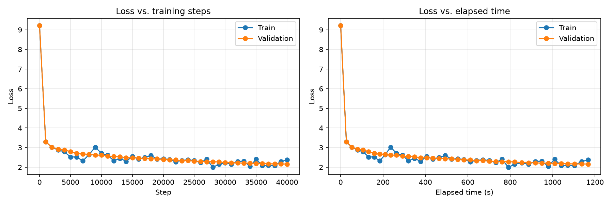

# Transformer Language Model from Scratch

基于 **Stanford CS336 Spring 2025 Assignment 1** 的个人实现。纯粹toy，目的旨在于学习Transformer架构以及学会使用 PyTorch，理解部件工作原理并效仿。

项目完成了基础Transfomer架构，利用pytorch张量运算和自动微分，实现字节级 BPE、Decoder-only Transformer、优化器，以及从文本预处理到训练和生成的完整流程，同时希望连接到 AI Infra 中的计算与内存问题。原始框架、测试接口和作业说明来自 [Stanford 课程仓库](https://github.com/stanford-cs336/assignment1-basics/tree/spring2025)。

- **约 2.99M 参数**：在完整 TinyStories 数据源上完成 **40,960,000 个训练 token** 的预算。
- **BPE 性能优化**：50 MiB 固定输入上的端到端耗时由 7.62 秒降至 4.56 秒，约 **1.67 倍加速**，同时记录内存代价。
- **分批编码与内存映射**：将约 2.23 GB 训练文本编码为 541,229,347 个 `uint16` ID，并通过 `np.memmap` 按批次读取。
- **两类架构消融**：完成移除 RMSNorm、降低学习率恢复稳定性，以及 NoPE 与 RoPE 的比较。
- **当前进度**：训练和基础生成已完成；KV Cache、推理性能对比和模型资产自动校验尚未完成。

## 已实现的模块

| 模块 | 实现内容 | 主要代码 |
|---|---|---|
| BPE 训练 | UTF-8 字节词表、特殊 token 隔离、正则预分词、频次加权、确定性合并 | [bpe.py](cs336_basics/bpe.py) |
| Tokenizer | 按训练顺序应用 merges，支持 encode、decode、encode_iterable 和文件加载 | [tokenizer.py](cs336_basics/tokenizer.py) |
| Transformer | Linear、Embedding、RMSNorm、SiLU、SwiGLU、RoPE、因果多头注意力、Pre-norm Block 和 LM | [layers.py](cs336_basics/layers.py) |
| 优化与训练 | AdamW、warmup 与余弦学习率、梯度裁剪、随机批次、验证、进度条和 checkpoint | [optim.py](cs336_basics/optim.py)、[train.py](cs336_basics/train.py) |
| 数据管线 | 按文档边界分块编码、二进制写入、只读内存映射和 next-token 批次 | [encode_train-stream.py](cs336_basics/encode_train-stream.py)、[data.py](cs336_basics/data.py) |
| 生成与记录 | 温度与 top-p 采样、EOS 停止、CSV 指标和学习曲线 | [generate.py](cs336_basics/generate.py)、[plot_metrics.py](cs336_basics/plot_metrics.py) |

模型核心层使用自定义实现，没有直接调用 `nn.Linear`、`nn.Embedding`、内置多头注意力或内置 AdamW。PyTorch 提供张量计算、参数管理和自动微分。

## 实验结果

实验环境为 **MacBook Air / Apple M5、Python 3.11、PyTorch 2.6.0**。模型训练使用 MPS 和 FP32，BPE 与语料编码使用 CPU。下述数据为本机实验结果。

### BPE：减少重复计算与全量扫描

主要优化依次包括：

1. 对相同预分词累计频次，统计相邻 pair 时按词频加权。
2. 增量维护 pair 计数，仅移除受影响序列的旧贡献并加入新贡献。
3. 建立 `pair → 包含它的预分词` 倒排索引，缩小每轮合并的搜索范围。
4. 先统计预分词字符串，随后只对不同字符串构造 UTF-8 字节元组。
5. 使用堆选择最佳 pair，以频次和字典序决定优先级；弹出时校验当前频次，跳过过期候选。

约 50 MiB 输入、10,000 词表、不开启 cProfile 时的测量：

| 实现阶段 | 实际耗时 real | 峰值 RSS |
|---|---:|---:|
| 已有增量计数与倒排索引，未加入上述第 4、5 项 | 7.62 秒，单次 | 385.75 MiB |
| 加入字符串去重编码和堆选择 | **4.56 秒，三次中位数** | **447.14 MiB，三次最大值** |

新版本三次 real 分别为 4.90、4.47、4.56 秒。相较此前单次记录，代表耗时减少约 **40.2%**，峰值 RSS 增加约 **15.9%**，体现了计算和存储之间的取舍。

输入实际为 52,428,193 字节；real 包含解释器启动、导入、读取和 BPE 训练。这是两项优化的共同收益，未把 profiler 时间与普通运行时间混算。全量 BPE 已完成，但其独立耗时和峰值 RSS 未归档，上表不代表 2.23 GB 全量输入的性能。

### 数据管线

BPE 仅使用官方训练文本学习；验证文本使用同一套 vocab 和 merges 编码，不参与词表训练。特殊 token 为 `<|endoftext|>`。

| 产物 | token 数量 | 格式 / 大小 |
|---|---:|---|
| 训练集 `train.bin` | **541,229,347** | 原始 `uint16`，1,082,458,694 字节，约 1,032.31 MiB |
| 验证集 `valid.npy` | **5,465,883** | 一维 `uint16` NumPy 数组 |
| 分词器 | vocab 10,000 / merges 9,743 | 两份配套的 pickle 文件 |

训练文本编码时，在最后一个完整文档结束符处划分块，保留空白与末尾文本。每块编码完成后立即写入文件，避免构建包含全体 token 的 Python 整数列表。

训练时使用 `np.memmap` 读取 `train.bin`，验证集使用 `np.load(..., mmap_mode="r")`。存储用 `uint16`，构造模型输入和目标时转换为 `torch.long`。

已检查全文件 ID 范围、解码字节总量及文档结束符数量，并对照语料首尾的编码结果；另外通过了 56 组分块边界一致性检查。验证集一次纯 encode 测量为 **9.67 秒、2.22 MiB/s**，不包含读取、解码校验和保存。

### 模型训练与消融

基线为 2 层 Decoder-only Transformer：`d_model=128`、4 个注意力头、`d_ff=384`、上下文长度 64、词表 10,000，总参数量 **2,986,624**。

每轮预算为 `40,000 × 16 × 64 = 40,960,000` 个 token，从完整训练集随机采样。AdamW 使用 β=(0.9, 0.999)、eps=1e-8、weight decay=0.01；梯度裁剪阈值为 1.0。

| 实验 | 最大学习率 | 训练步数 | 验证 loss | 验证 PPL |
|---|---:|---:|---:|---:|
| 基线：RMSNorm + RoPE + SwiGLU | 1e-2 | 40,000 | **2.1614** | **8.6835** |
| 移除全部 RMSNorm | 1e-2 | 4,000，中断 | 7442.5418，终端记录 | — |
| 移除全部 RMSNorm，降低学习率 | 1e-3 | 40,000 | 2.2834 | 9.8100 |
| NoPE：保留 RMSNorm 和因果掩码，关闭 RoPE | 1e-2 | 40,000 | 2.2751 | 9.7287 |

- 在这组配置下，移除 RMSNorm 后，学习率随 warmup 升高时训练失稳；降低十倍学习率后恢复稳定。
- 原高学习率运行在计算 `exp(val_loss)` 时溢出，中断点为第 4,000 步；该次 CSV 只到第 3,000 步。之后补充了 PPL 溢出保护，保留真实 loss，将超出表示范围的 PPL 记录为 `inf`。
- NoPE 仍然能够学习，但本轮固定验证采样上的结果弱于 RoPE 基线。
- 这些是单次、固定种子的对照结果；低学习率无 RMSNorm 与基线同时存在学习率差异，不能据此断言所有配置下的最佳性能。

**指标口径：**每次验证固定采样 10 个 batch、每批 4 段、每段 64 个 token，计算 2,560 个预测位置的平均交叉熵；不是完整验证集的均值。训练设置 NumPy / PyTorch 种子 42，验证采样使用种子 123，并恢复训练采样的随机状态。



原始指标：[基线 CSV](logs/ts_full_baseline.csv)、[无 RMSNorm / 高学习率](logs/ts_full_no_rmsnorm_lr1e2.csv)、[无 RMSNorm / 低学习率](logs/ts_full_no_rmsnorm_lr1e3.csv)、[NoPE](logs/ts_full_nope.csv)。历史过程见 [实验记录](experiment_log.md)。

### 生成样例与一次工程问题

以下为基线检查点在 CPU 上的短生成调试片段，temperature=0.8、top-p=0.9，保留原文：

> Once upon a time, there was a little rabbit named Remy. Remy liked to play with his friends and friends. They would run, jump, and laugh all day long.

小模型仍有短语重复和长程连贯性问题；这个片段不作为完整故事质量评测。

调试中曾出现生成词表与训练词表错配：两份词表同为 10,000 项，却有 9,655 个 ID 的含义不同，模型加载不会因此报维度错误。现已统一生成入口的 vocab 与 merges。后续将把模型配置、词表标识和 checkpoint 绑定校验，避免继续依赖人工配套。

## 运行流程

### 1. 安装环境

在仓库根目录执行；本项目实测使用 Conda 管理 Python，pip 安装项目依赖：

```bash
conda create -n cs336 python=3.11 -y
conda activate cs336
python -m pip install -e .
python -m pip install matplotlib
```

`matplotlib` 用于绘图，目前未单独声明在 `pyproject.toml` 中，因此需额外安装。

设备在 [config.py](cs336_basics/config.py) 的 `DEVICE` 中设置：Apple Silicon 使用 `"mps"`，CPU 使用 `"cpu"`。仓库的性能数字来自上述 M5 环境，未进行 CUDA 性能测量。

### 2. 下载 TinyStories

来源：[TinyStories 数据集](https://huggingface.co/datasets/roneneldan/TinyStories)。已有文件可跳过下载。

```bash
mkdir -p data/tinystories
curl -fL -C - -o data/tinystories/TinyStoriesV2-GPT4-train.txt https://huggingface.co/datasets/roneneldan/TinyStories/resolve/main/TinyStoriesV2-GPT4-train.txt
curl -fL -C - -o data/tinystories/TinyStoriesV2-GPT4-valid.txt https://huggingface.co/datasets/roneneldan/TinyStories/resolve/main/TinyStoriesV2-GPT4-valid.txt
```

### 3. 学习分词器并编码

```bash
python -m cs336_basics.train_bpe_full
python -m cs336_basics.encode_tinystories
python cs336_basics/encode_train-stream.py
```

第三个入口的文件名目前包含连字符，因此按文件路径运行。输出位于：

```text
artifacts/tinystories/
├── vocab.pkl
├── merges.pkl
├── train.bin
└── valid.npy
```

`train.bin` 没有 NumPy 文件头，读取时必须指定 dtype：

```python
train_data = np.memmap(train_path, dtype=np.uint16, mode="r")
valid_data = np.load(valid_path, mmap_mode="r")
```

原始语料、token 数组、权重和 profile 文件应在本地生成，不作为源码仓库的常规提交内容；上传前在 `.gitignore` 中排除 `data/`、`artifacts/` 等产物目录，保留源码、CSV 和曲线。

### 4. 复现基线训练

**当前配置保留最近一次 NoPE 实验。**复现基线前，在 [config.py](cs336_basics/config.py) 中恢复：

```python
USE_RMSNORM = True
ROPE_THETA = 10000

D_MODEL = 128
NUM_LAYERS = 2
NUM_HEADS = 4
D_FF = 384
CONTEXT_LENGTH = 64
BATCH_SIZE = 16

NUM_STEPS = 40000
WARMUP_STEPS = 4000
EVAL_STEPS = 1000
MAX_LR = 1e-2
MIN_LR = 1e-3
RESUME_PATH = None

CHECKPOINT_PATH = ROOT_DIR / "artifacts/tinystories/ts_full_baseline.pt"
METRICS_PATH = ROOT_DIR / "logs/ts_full_baseline.csv"
PLOT_PATH = ROOT_DIR / "plots/ts_full_baseline.png"
```

重复实验时为输出文件换一个名称；从头训练会重新创建该 CSV，并更新对应检查点。执行：

```bash
python -m cs336_basics.train
python -m cs336_basics.plot_metrics
```

完整语料仍通过 `TRAIN_TOTAL_PATH` 和 `VALID_TOTAL_PATH` 读取；`config.py` 中保留的小样本路径不参与当前训练入口。

CSV 的 `elapsed_s` 在本步验证与保存之前记录，包含此前验证和保存等开销，不含初始化、数据预处理及最后一次验证和保存的完整耗时，不作为严格设备基准。

### 5. 生成文本

保持训练时的模型参数和同一套 vocab / merges，令 `CHECKPOINT_PATH` 指向对应权重：

```bash
python -m cs336_basics.generate
```

提示词在 [generate.py](cs336_basics/generate.py) 的 `prompt` 中设置，温度和 top-p 在配置中设置。当前最多新增 256 个 token，生成 EOS 时提前停止；每步重算最近 64 个 token，尚未使用 KV Cache。

### 6. 运行消融

以基线为起点，仅调整对应变量，均从头训练，并为 checkpoint、CSV 和图像设置独立文件名：

| 实验 | USE_RMSNORM | ROPE_THETA | 最大 / 最小学习率 | 文件名前缀 |
|---|---|---|---|---|
| 无 RMSNorm / 高学习率 | False | 10000 | 1e-2 / 1e-3 | ts_full_no_rmsnorm_lr1e2 |
| 无 RMSNorm / 低学习率 | False | 10000 | 1e-3 / 1e-4 | ts_full_no_rmsnorm_lr1e3 |
| NoPE | True | None | 1e-2 / 1e-3 | ts_full_nope |

训练预算、数据和其余模型设置与基线一致。检查点当前不保存模型配置，加载不同实验权重时需同步切换开关。

## 测试与性能分析

课程测试通过 [tests/adapters.py](tests/adapters.py) 接入实现。测试包括 BPE 合并结果和特殊 token、tokenizer 往返与参考实现对齐、模型层和前向计算、优化器、数据采样及序列化。

```bash
python -m pytest tests/test_train_bpe.py tests/test_model.py tests/test_nn_utils.py tests/test_optimizer.py tests/test_data.py tests/test_serialization.py -q
python -m pytest tests/test_tokenizer.py -q
```

参考 tokenizer 测试首次运行可能需要下载 tiktoken 的 GPT-2 编码资源；两个基于地址空间限制的内存测试在 macOS 上按测试条件跳过。缓存路径的正确性与速度验证将在实现 KV Cache 后另行补充。

复测当前 50 MiB BPE 实现，先准备相同规模的样本：

```bash
python - <<'PY'
from pathlib import Path
from cs336_basics.prepare_scale_sample import make_subset

folder = Path("data/tinystories")
make_subset(
    folder / "TinyStoriesV2-GPT4-train.txt",
    folder / "train_50MiB.txt",
    50 * 1024 * 1024,
)
PY
/usr/bin/time -l python -m cs336_basics.profile_bpe
```

上述 `/usr/bin/time -l` 为 macOS 命令，报告整个脚本的耗时和资源使用。定位热点时另行使用 cProfile：

```bash
mkdir -p artifacts/bpe_scale
python -m cProfile -o artifacts/bpe_scale/bpe_current.prof -m cs336_basics.profile_bpe
python -c "import pstats; pstats.Stats('artifacts/bpe_scale/bpe_current.prof').strip_dirs().sort_stats('cumtime').print_stats(15)"
```

Profiler 会增加运行开销；优化前的历史测量记录见实验文档，当前入口用于复测当前实现。

## 目录与当前限制

```text
cs336_basics/
├── bpe.py / tokenizer.py          # 分词器训练与编解码
├── layers.py                     # 自定义模型层与 Transformer
├── optim.py / data.py             # 优化器、学习率、采样
├── train.py / checkpoint.py       # 训练和保存恢复
├── train_bpe_full.py              # 全量训练文本学习 BPE
├── encode_tinystories.py          # 验证集编码和检查
├── encode_train-stream.py         # 训练集分块编码
├── generate.py                   # 基础自回归生成
└── metrics.py / plot_metrics.py   # CSV 与曲线
tests/                            # 课程测试及适配接口
logs/                             # 已记录的实验指标
plots/                            # 学习曲线
experiment_log.md                  # 详细历史记录
```

- BPE 训练目前整文件读取；语料编码阶段按文档边界分块处理。
- 生成阶段仍重复计算窗口内 token，尚无 KV Cache、批量服务或自定义 GPU 算子。
- checkpoint 保存模型、优化器和步数，尚未保存模型配置、分词器标识或随机数状态；续训不保证逐步完全复现。
- 部分早期探索脚本保留本机路径；推荐使用上面的运行入口。历史实验记录中的本机链接也仍需整理，在线结果以本页相对链接为准。

后续收尾：

- [ ] 实现 KV Cache，核对整段前向与增量前向的一致性，明确位置和窗口策略。
- [ ] 在相同生成条件下测量延迟、吞吐和缓存占用，报告实测收益与代价。
- [ ] 绑定 checkpoint、模型配置与 tokenizer，并进一步整理可复现入口。

## 来源与许可证

课程框架、测试和原始接口来自 [Stanford CS336 Spring 2025 Assignment 1](https://github.com/stanford-cs336/assignment1-basics/tree/spring2025)，作业说明见 [课程 PDF](cs336_spring2025_assignment1_basics.pdf)。本仓库是个人学习与实验实现，不是官方参考答案。

保留原始版权与许可证，见 [LICENSE](LICENSE)。

