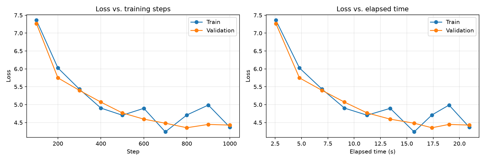
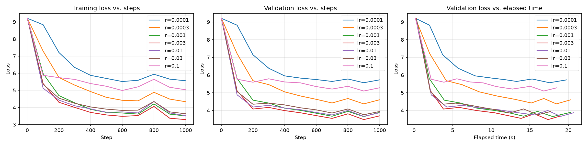
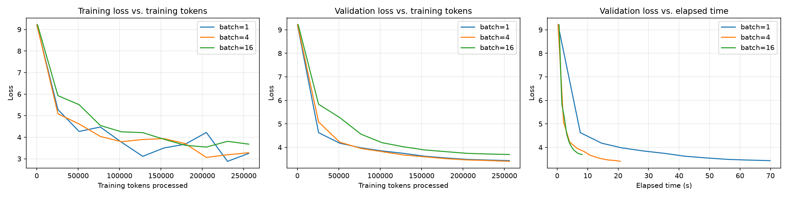
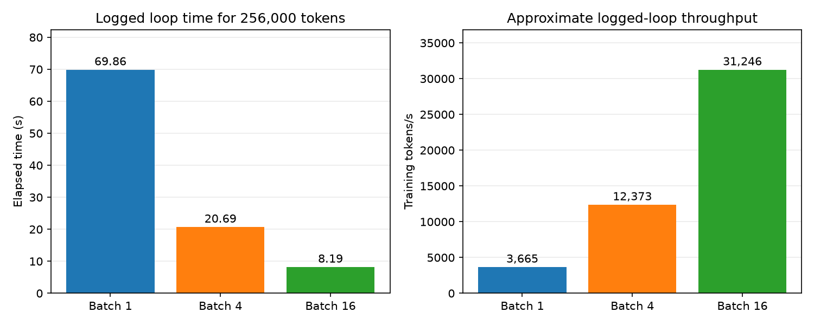
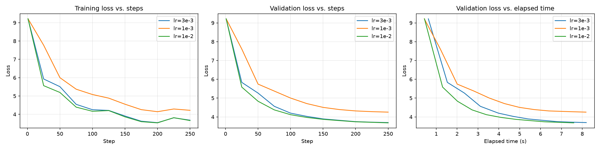
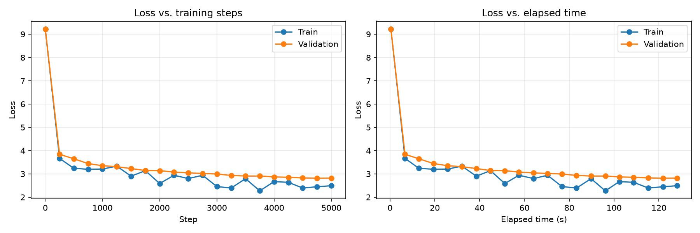

# CS336 Assignment 1 实验记录

## smoke_001：小语料训练流程检查

### 实验目的

检查分词器、模型、训练、验证、日志和绘图是否能够完整运行。

### 数据与配置

- 数据：官方 corpus.en 测试语料。
- 训练/验证划分：token 序列按 90% / 10% 切分。
- 词表大小：500。
- 模型维度 d_model：64。
- Transformer 层数：2。
- 每层注意力头数：4。
- 前馈层维度 d_ff：128。
- 上下文长度：32。
- Batch size：4。
- 训练步数：200。
- 最大学习率：3e-4。
- 最小学习率：3e-5。
- Warmup：10 步。
- 优化器：AdamW。
- 设备：MPS。
- 数据类型：float32。
- 每 20 步验证并记录一次。

### 实验结果

- 第 20 步验证 loss：约 6.2993。
- 第 200 步训练 loss：约 5.5825。
- 第 200 步验证 loss：约 5.7246。
- 最终验证困惑度：约 306.31。
- 第 200 步记录的累计耗时：约 3.72 秒。

### 观察

训练 loss 和验证 loss 整体下降，期间存在少量波动。
训练、验证、日志和绘图流程能够完整运行。

这次使用小语料和较少训练步数，作为流程检查，
不作为正式 TinyStories 实验成绩。

### 结果文件

- 指标日志：/Users/soverean/cs336-a1-2025/logs/smoke_001.csv
- 学习曲线：plots/smoke_001.png

## ts_pilot_001：TinyStories 小规模训练试跑

记录日期：2026-10-12。

### 实验目的

使用 TinyStories 样本训练专用的 10k BPE tokenizer，并验证文本预处理、token 文件、模型训练、验证、checkpoint、指标日志和学习曲线能够接入同一套流程。

本次是小规模流程基线，用于为后续正式 TinyStories 训练和学习率实验准备可用的数据及模型管线。

### 数据与分词器

- 数据来源：项目测试夹具 tinystories_sample_5M.txt，文件大小 5,242,880 字节，即 5 MiB。
- BPE 词表大小：10,000。
- BPE merges 数量：9,743，等于 10,000 - 256 个初始字节 - 1 个特殊 token。
- 特殊 token：<|endoftext|>，ID 为 256。
- 文本按 <|endoftext|> 切分，剔除空白文档；前 90% 文档用于训练，后 10% 用于验证，并保留文档结束符。
- 训练 token 数：1,143,921；验证 token 数：127,341。
- token 文件：一维 uint16 数组；训练时使用只读 memmap 加载，采样后转换为 torch.long。
- 训练 ID 范围：10–9999；验证 ID 范围：10–9994，均位于词表范围内。

BPE 的独立训练耗时没有保存在本次 CSV 中，因此本记录不填写该耗时。

### 模型与训练配置

| 项目 | 配置 |
|---|---|
| 模型 | Decoder Transformer，使用 RMSNorm、RoPE 和 SwiGLU |
| 参数量 | 2,986,624，约 2.99M |
| 词表大小 | 10,000 |
| d_model | 128 |
| Transformer 层数 | 2 |
| 每层注意力头数 | 4 |
| d_ff | 384 |
| context_length | 64 |
| RoPE theta | 10,000 |
| batch_size | 4 |
| 更新步数 | 1,000 |
| 优化器 | AdamW |
| 最大学习率 / 最小学习率 | 3e-4 / 3e-5 |
| 学习率调度 | 100 步 warmup，随后余弦衰减 |
| AdamW betas | (0.9, 0.999) |
| AdamW eps | 1e-8 |
| weight_decay | 0.01 |
| 最大梯度 L2 范数 | 1.0 |
| 设备配置 | MPS |
| 浮点类型 | float32 |
| 初始化方式 | 从头训练，RESUME_PATH=None |
| 验证频率 | 每 100 步 |
| 每次验证 | 随机采样 10 个 batch，取平均 loss |

训练采用随机窗口采样。本轮累计处理 token 数为 4 × 64 × 1000 = **256,000**，该数量包含重复采样的 token。

### 实验结果

| Step | 记录的累计时间（秒） | 当前训练 batch loss | 平均验证 loss | 验证困惑度 |
|---:|---:|---:|---:|---:|
| 100 | 2.5685 | 7.3601 | 7.2674 | 1432.87 |
| 200 | 4.8055 | 6.0258 | 5.7485 | 313.71 |
| 300 | 6.9480 | 5.4339 | 5.3996 | 221.31 |
| 400 | 9.0800 | 4.9039 | 5.0712 | 159.37 |
| 500 | 11.2312 | 4.7046 | 4.7688 | 117.78 |
| 600 | 13.4230 | 4.8972 | 4.5944 | 98.93 |
| 700 | 15.6981 | 4.2392 | 4.4811 | 88.33 |
| 800 | 17.3807 | 4.7109 | 4.3547 | 77.85 |
| 900 | 19.0096 | 4.9883 | 4.4472 | 85.38 |
| 1000 | 20.9308 | 4.3707 | 4.4287 | 83.82 |

- 最终训练 loss：**4.3707**。
- 最终验证 loss：**4.4287**。
- 最终验证困惑度：**83.82**，按 exp(val_loss) 计算。
- 最低已记录验证 loss：**4.3547**，出现在第 **800** 步，对应困惑度 **77.85**。
- 第 1000 步记录的累计时间：**20.9308 秒**。
- 最终 checkpoint 的 iteration 为 1000，AdamW 各参数状态的更新计数也为 1000。

时间指标从训练循环开始计时，并在当前训练步结束、当次验证和保存之前取值。因此最后一行的时间不包含最后一次验证及保存的完整耗时，也不包含 BPE 和数据预处理耗时。

### 学习曲线与观察



1. 验证 loss 从第 100 步的 7.2674 降至最终的 4.4287，说明这轮训练使模型在试跑验证文本上的预测损失明显降低。
2. 训练 loss 使用当前随机 batch，验证 loss 使用另行抽样的 10 个 batch，两者均存在采样波动。
3. 第 800 步的验证 loss 最低，之后略有回升。仅凭这轮短训练和抽样验证结果，尚不足以确认出现稳定的过拟合。
4. 当前结果支持数据和训练管线可用，后续需要扩大训练规模并比较不同学习率。

### 试跑范围与限制

- 本次 tokenizer 在完整 5 MiB 样本上学习，之后才划分训练、验证文档。验证文本参与了词表学习，因此这些指标用于流程调试。
- 正式实验应使用独立验证文本，BPE 只在训练文本上拟合。
- 本轮只记录了一个学习率配置，尚不能据此确定最优学习率。
- 本次日志未记录随机种子，验证 batch 也不是固定的一组；后续比较实验需要记录随机种子及验证采样方式。
- 本记录未包含生成文本样例，对生成流畅度暂不作结论。

### 结果文件

- [样本语料](/Users/soverean/cs336-a1-2025/tests/fixtures/tinystories_sample_5M.txt)
- [词表 vocab.pkl](/Users/soverean/cs336-a1-2025/artifacts/tinystories_pilot/vocab.pkl)
- [合并顺序 merges.pkl](/Users/soverean/cs336-a1-2025/artifacts/tinystories_pilot/merges.pkl)
- [训练 tokens](/Users/soverean/cs336-a1-2025/artifacts/tinystories_pilot/train_data.npy)
- [验证 tokens](/Users/soverean/cs336-a1-2025/artifacts/tinystories_pilot/test_data.npy)
- [最终 checkpoint](/Users/soverean/cs336-a1-2025/artifacts/tinystories_pilot/model_pilot_001.pt)
- [指标 CSV](/Users/soverean/cs336-a1-2025/logs/ts_pilot_001.csv)
- [学习曲线 PNG](plots/ts_pilot_001.png)

<!-- 2026-10-13 更新：本段依据当前七份 CSV 重写，替换旧的三组学习率比较及其后续进度说明；表格由 CSV 提取，配套图已按当前日志重新生成。 -->

## ts_lr_sweep_001：TinyStories 学习率扩展比较（7 组）

记录日期：2026-10-13。

### 实验目的与搜索方法

先比较 `1e-4、3e-4、1e-3`，再加入 `3e-3、1e-2、3e-2、1e-1`，扩大搜索范围，
观察学习率调度对短期收敛和验证 loss 的影响，以及较大学习率是否会导致训练效果下降或发散。

七组均使用 100 步 warmup 和随后余弦衰减，最小学习率固定为最大学习率的 10%。
因此本轮比较的是七组按相同比例缩放的学习率调度，上下限同时变化。

### 共同配置

| 项目 | 配置 |
|---|---|
| 数据来源 | TinyStories 测试样本 `tinystories_sample_5M.txt`，5 MiB |
| 数据划分 | 按文档前 90% / 后 10% 划分训练与验证 |
| 分词器 | 词表 10,000，merges 9,743；结束符 ID 为 256 |
| 训练 / 验证 token 数 | 1,143,921 / 127,341 |
| 存储与加载 | 一维 uint16 数组，训练时使用只读 memmap |
| 模型 | 2 层 Decoder Transformer，使用 RMSNorm、RoPE 和 SwiGLU |
| 参数量 | 2,986,624 |
| d_model / num_heads / d_ff | 128 / 4 / 384 |
| RoPE theta | 10,000 |
| batch_size / context_length | 4 / 64 |
| 更新步数 / warmup | 1,000 / 100 |
| AdamW | betas=(0.9, 0.999)，eps=1e-8，weight_decay=0.01 |
| 梯度裁剪 | 全部参数梯度的 L2 范数上限为 1.0 |
| 设备 / 类型 | MPS / float32 |
| 随机种子 | NumPy 和 PyTorch 均设置为 42 |
| 初始化 | 从头构建模型和优化器，RESUME_PATH=None |
| 验证方式 | 每次随机抽样 10 个 batch，取平均 loss |
| 记录点 | 1、100、200、300、400、500、600、700、800、900、1000 |

每组累计处理 **4 × 64 × 1000 = 256,000** 个训练 token，其中可能包含重复采样。
固定随机种子用于控制初始化和随机窗口抽样，本记录不据此保证不同设备下完全一致。

### 结果汇总

以下结果直接取自当前七份 CSV。最大学习率和最小学习率分别为：

| 最大 / 最小 LR | 最终训练 loss | 最终验证 loss | 最终验证 PPL | 最低已记录验证 loss | 最低所在步 | 第 1000 步记录时间（秒） |
|---|---:|---:|---:|---:|---:|---:|
| 1e-4 / 1e-5 | 5.5598 | 5.7270 | 307.04 | 5.5650 | 900 | 19.7776 |
| 3e-4 / 3e-5 | 4.3357 | 4.5994 | 99.43 | 4.3663 | 900 | 20.3127 |
| 1e-3 / 1e-4 | 3.5024 | 3.8855 | 48.69 | 3.6484 | 900 | 20.2830 |
| 3e-3 / 3e-4 | 3.2900 | 3.6883 | 39.97 | 3.4772 | 900 | 19.0290 |
| 1e-2 / 1e-3 | 3.5177 | 3.8652 | 47.71 | 3.6598 | 900 | 20.6724 |
| 3e-2 / 3e-3 | 3.6325 | 3.9340 | 51.11 | 3.7514 | 900 | 17.7043 |
| 1e-1 / 1e-2 | 5.0346 | 5.2785 | 196.08 | 5.0954 | 900 | 18.5053 |

**当前七组中，`3e-3 / 3e-4` 得到最低的最终验证 loss 和最低已记录验证 loss。**
其最终验证 loss 为 **3.6883**，PPL 为 **39.97**；
第 900 步最低已记录验证 loss 为 **3.4772**，对应 PPL 为 **32.37**。

七组日志均包含 11 个记录点并到达第 1000 步，所有已记录字段均为有限数。
“最低已记录”仅指这些记录点中的最低值，并不代表检查了每一步的验证 loss。

### 验证 loss 随步数变化

| Step | 1e-4 | 3e-4 | 1e-3 | 3e-3 | 1e-2 | 3e-2 | 1e-1 |
|---:|---:|---:|---:|---:|---:|---:|---:|
| 1 | 9.2129 | 9.2129 | 9.2129 | 9.2129 | 9.2129 | 9.2129 | 9.2129 |
| 100 | 8.8237 | 7.2110 | 5.8013 | 5.1076 | 4.8791 | 5.0611 | 5.7628 |
| 200 | 7.1500 | 5.6798 | 4.5779 | 4.0748 | 4.1875 | 4.3479 | 5.5946 |
| 300 | 6.3859 | 5.4574 | 4.4122 | 4.1671 | 4.2838 | 4.4095 | 5.7873 |
| 400 | 5.9528 | 5.0495 | 4.1248 | 3.9864 | 4.1319 | 4.3083 | 5.6087 |
| 500 | 5.8275 | 4.8155 | 3.9994 | 3.8634 | 4.0351 | 4.1456 | 5.5577 |
| 600 | 5.7451 | 4.6254 | 3.8372 | 3.7015 | 3.8779 | 4.0277 | 5.3461 |
| 700 | 5.6378 | 4.4173 | 3.6675 | 3.5445 | 3.7388 | 3.8495 | 5.2069 |
| 800 | 5.7763 | 4.6715 | 3.9417 | 3.8037 | 3.9911 | 4.0793 | 5.3623 |
| 900 | 5.5650 | 4.3663 | 3.6484 | 3.4772 | 3.6598 | 3.7514 | 5.0954 |
| 1000 | 5.7270 | 4.5994 | 3.8855 | 3.6883 | 3.8652 | 3.9340 | 5.2785 |

七组第 1 步训练 loss 均为 **9.20994854**，验证 loss 均为 **9.21293058**，学习率均为 **0**。
它们接近均匀预测的参考值 `ln(10000) ≈ 9.2103`。
相同初始化和相同输入下，第一次更新前的 loss 不依赖学习率。
从第 100 步开始出现的差异，反映的是已经发生的训练过程。

### 学习曲线



此图使用当前七份 CSV 重新绘制。三幅图依次为：

1. 当前训练 batch 的 loss 随训练步数变化。
2. 随机抽样验证 batch 的平均 loss 随训练步数变化。
3. 平均验证 loss 随记录的累计时间变化。

图例的学习率表示调度的最大值，实际学习率会先 warmup，再余弦衰减。
项目中的原始对比图仍可查看：[lr_comparison.png](plots/lr_comparison.png)；
本节的数值和配套图以当前 CSV 为准。

### 结果分析

1. **学习率较小时，当前短训练预算下下降较慢。**
   `1e-4` 的最终验证 loss 为 5.7270；
   增大到 `3e-4` 和 `1e-3` 后，分别降至 4.5994 和 3.8855。

2. **扩展搜索后，候选学习率由 1e-3 更新为 3e-3。**
   `3e-3` 在当前 1000 步预算下优于其余六组。
   它是此次已测试配置中的最佳结果，尚不能据此确定更大模型、更多训练步数或正式数据上的最优学习率。

3. **继续增大学习率并未继续改善最终结果。**
   `1e-2、3e-2` 的最终验证 loss 分别为 3.8652、3.9340。
   虽然 `1e-2` 在第 100 步的验证 loss 最低，但其最终结果不如 `3e-3`；
   早期下降快与最终验证效果最好是两个不同的评价。

4. **1e-1 效果明显变差，但当前记录不支持“已经发散”。**
   其最终验证 loss 为 5.2785，明显高于 `3e-3` 的 3.6883；
   但仍低于初始约 9.21，并完成了 1000 步训练。
   已记录曲线没有持续上升或出现 NaN / Inf，当前可以得出“过大的学习率使本轮效果下降”，
   不能写成“找到了发散学习率”或“确定了稳定性边界”。

5. **第 900 步是七组最低已记录验证点，最后一步均有回升。**
   验证使用随机窗口，且各组沿用相同抽样规则。
   单个记录点的回升不足以确认稳定过拟合，应结合固定验证样本或更完整的验证评估判断。

6. **耗时仅作为学习曲线参考。**
   七组第 1000 步记录的累计时间约为 17.70–20.67 秒。
   本轮没有控制设备热机和后台负载等计时条件，不能据此认定某个学习率计算速度更快。

### 日志与训练代码进展

训练循环的索引从 0 开始，CSV 保存 `step + 1`，
所以循环索引 0 在图中显示为第 1 步。绘图直接使用 CSV 的步数，不再加 1。

- `train_loss` 在本步更新权重前计算，来自当前训练 batch。
- `val_loss` 在本步更新完成后计算，是 10 个验证 batch 的平均值。
- `val_ppl = exp(val_loss)`。
- `elapsed_s` 在本步验证与保存之前取值，不包含最后一次验证和保存的完整耗时，也不包含 BPE 与预处理。
- 第一循环步的学习率为 0，该步没有改变模型权重；这仍是循环第一步的日志，不是单独增加的训练前评估。

最新代码已完成两项调整：

1. [train.py](/Users/soverean/cs336-a1-2025/cs336_basics/train.py:53) 已恢复读取 `config.MAX_LR` 和 `config.MIN_LR`。
   原记录中“仍硬编码学习率”的待办已经解决。当前 config 的 `1e-2 / 1e-3` 仅表示当前选中的配置，
   不能用它代表七组历史实验；每组实际学习率以各自 CSV 为准。
2. [train.py](/Users/soverean/cs336-a1-2025/cs336_basics/train.py:67) 已增加训练 loss 非有限值时的报错停止保护，位置在反向传播之前。
   该保护检查训练 loss，不等同于逐步检查全部梯度、模型参数和优化器状态。

每次记录和训练结束时使用同一 checkpoint 路径保存，会覆盖较早的模型。
目前没有单独保留第 900 步模型，不能把最终 checkpoint 称为最低验证 loss 对应的最佳模型。

### 实验范围与限制

- 本轮仍使用 5 MiB 样本，训练预算为每组 256,000 tokens，尚未完成正式规模训练。
- BPE 在整个样本上学习后才划分训练和验证文档，验证文本参与了词表学习；
  正式实验应使用训练文本拟合 BPE，并使用独立验证文本。
- 每次验证随机抽样 10 × 4 × 64 = 2,560 个目标 token，并未遍历整个验证集。
- 验证和训练共享 NumPy 随机状态；本轮七组采用相同记录频率，改变频率会改变后续训练窗口序列。
- 每个学习率只有当前这一轮结果，没有跨多个随机种子的重复实验，不能据此判断细小差异是否稳定。
- 尚未观察到明确发散，仍未完成稳定性边界的取证。
- 本节没有新的生成文本，暂不评价生成流畅度。

### 结果文件

| 实验 | 原始指标 | 保存的模型 | 原单组曲线 |
|---|---|---|---|
| `ts_lr_1e4` | [CSV](/Users/soverean/cs336-a1-2025/logs/ts_lr_1e4.csv) | [checkpoint](/Users/soverean/cs336-a1-2025/artifacts/tinystories_pilot/ts_lr_1e4.pt) | [单组曲线](plots/ts_lr_1e4.png) |
| `ts_lr_3e4` | [CSV](/Users/soverean/cs336-a1-2025/logs/ts_lr_3e4.csv) | [checkpoint](/Users/soverean/cs336-a1-2025/artifacts/tinystories_pilot/ts_lr_3e4.pt) | [单组曲线](plots/ts_lr_3e4.png) |
| `ts_lr_1e3` | [CSV](/Users/soverean/cs336-a1-2025/logs/ts_lr_1e3.csv) | [checkpoint](/Users/soverean/cs336-a1-2025/artifacts/tinystories_pilot/ts_lr_1e3.pt) | [单组曲线](plots/ts_lr_1e3.png) |
| `ts_lr_3e3` | [CSV](/Users/soverean/cs336-a1-2025/logs/ts_lr_3e3.csv) | [checkpoint](/Users/soverean/cs336-a1-2025/artifacts/tinystories_pilot/ts_lr_3e3.pt) | [单组曲线](plots/ts_lr_3e3.png) |
| `ts_lr_1e2` | [CSV](/Users/soverean/cs336-a1-2025/logs/ts_lr_1e2.csv) | [checkpoint](/Users/soverean/cs336-a1-2025/artifacts/tinystories_pilot/ts_lr_1e2.pt) | [单组曲线](plots/ts_lr_1e2.png) |
| `ts_lr_3e2` | [CSV](/Users/soverean/cs336-a1-2025/logs/ts_lr_3e2.csv) | [checkpoint](/Users/soverean/cs336-a1-2025/artifacts/tinystories_pilot/ts_lr_3e2.pt) | [单组曲线](plots/ts_lr_3e2.png) |
| `ts_lr_1e1` | [CSV](/Users/soverean/cs336-a1-2025/logs/ts_lr_1e1.csv) | [checkpoint](/Users/soverean/cs336-a1-2025/artifacts/tinystories_pilot/ts_lr_1e1.pt) | [单组曲线](plots/ts_lr_1e1.png) |

- [按当前 CSV 重新生成的七组对比图](plots/experiment_report/lr_comparison.png)

<!-- 2026-10-13 更新：保留已有实验记录，新增由当前 CSV 计算的吞吐量、batch size 实验和配套图；更新文末进度。未修改训练、模型或优化器源码。 -->

### 学习率实验补充：训练 token 吞吐量

按本轮各组最后一条日志计算：

```text
累计训练 token 数 = batch_size × context_length × 已完成训练步数
近似训练 token 吞吐量 = 累计训练 token 数 ÷ elapsed_s
```

| 实验 | 累计训练 tokens | 日志累计耗时（秒） | 近似吞吐量（tokens/s） |
|---|---:|---:|---:|
| `ts_lr_1e4` | 256,000 | 19.7776 | 12,944.0 |
| `ts_lr_3e4` | 256,000 | 20.3127 | 12,602.9 |
| `ts_lr_1e3` | 256,000 | 20.2830 | 12,621.4 |
| `ts_lr_3e3` | 256,000 | 19.0290 | 13,453.1 |
| `ts_lr_1e2` | 256,000 | 20.6724 | 12,383.6 |
| `ts_lr_3e2` | 256,000 | 17.7043 | 14,459.7 |
| `ts_lr_1e1` | 256,000 | 18.5053 | 13,833.8 |

这里统计的是包含重复随机窗口的训练 token，不是不同语料 token 的数量，也不包含验证 token。
七组模型和 batch size 相同，这些时间差不能用于断言某个学习率提高了计算效率。
所有速度都使用下文说明的日志计时口径，并非独立的 GPU 性能测试。

## ts_batch_comparison_001：固定训练 token 预算的 batch size 比较

记录日期：2026-10-13。

### 实验目的

比较 batch size 为 1、4、16 时，在相同训练 token 预算下的验证效果、累计耗时和训练 token 吞吐量。
同时观察在相同耗时内，各组验证 loss 的下降速度。

### 数据、模型与共同设置

沿用 TinyStories 5 MiB 样本、10k BPE 词表和 2,986,624 参数的模型。
上下文长度为 64，d_model=128、层数=2、num_heads=4、d_ff=384，设备配置为 MPS，类型为 float32。
三组均重新初始化模型和优化器，NumPy/PyTorch 种子为 42，RESUME_PATH=None。
共同最大学习率为 3e-3，最小学习率为 3e-4；AdamW、梯度裁剪与前述设置相同。

每组使用不同更新步数，统一累计处理 **256,000 个训练 token**。
Warmup 占总步数的 10%，周期验证间隔也占总步数的 10%。
以下设置已通过 CSV 中的步数和学习率列核对；当前 config 仅保留最后选择的 batch=16 配置。

| 训练 batch size | 总更新步数 | Warmup 步数 | 周期验证间隔（步） | 每步训练 tokens | 总训练 tokens |
|---:|---:|---:|---:|---:|---:|
| 1 | 4,000 | 400 | 400 | 64 | 256,000 |
| 4 | 1,000 | 100 | 100 | 256 | 256,000 |
| 16 | 250 | 25 | 25 | 1024 | 256,000 |

固定 token 数并不意味着固定更新次数。batch=16 比 batch=4 少做 4 倍更新，比 batch=1 少做 16 倍更新。
AdamW 动量更新和权重衰减也按更新步数发生，因此本实验比较的是固定数据预算下的训练策略，不能把差异只归因于硬件。

### 固定验证与随机状态处理

三组验证统一使用 **EVAL_BATCH_SIZE=4、EVAL_BATCHES=10**。
每次验证评估 4 × 10 × 64 = **2,560 个目标 token**；没有遍历整个验证集。

当前 evaluate 的正常执行顺序为：

```text
保存 NumPy 随机状态 → 设置验证种子 123 → 验证抽样和计算 loss → 恢复原状态
```

固定验证种子使每次选取相同的验证窗口。恢复随机状态使验证不消耗训练的随机抽样序列。
三份 CSV 的首步验证 loss 均为 **9.21603851**，支持首步评估的一致性。
三组首步训练 loss 分别为 **9.21839333、9.20994854、9.21272087**；
训练 batch 大小不同，平均 loss 略有差别属于预期情况。

本轮与之前学习率实验的验证抽样规则不同，恢复 NumPy 状态也改变了后续训练窗口序列。
因此不能把旧的 ts_lr_3e3 当作本轮 batch=4 的结果，也不能将两轮 loss 差异直接解释为某个超参数的效果。

### 结果与吞吐量

| Batch size | 最终训练 loss | 最终验证 loss | 最终 PPL | 最低已记录验证 loss | 最低所在步 | 日志累计耗时（秒） | 近似 tokens/s | 近似 steps/s |
|---:|---:|---:|---:|---:|---:|---:|---:|---:|
| 1 | 3.2493 | 3.4364 | 31.08 | 3.4364 | 4,000 | 69.8564 | 3,664.7 | 57.26 |
| 4 | 3.2818 | 3.4060 | 30.15 | 3.4060 | 1,000 | 20.6906 | 12,372.8 | 48.33 |
| 16 | 3.6797 | 3.6975 | 40.34 | 3.6975 | 250 | 8.1931 | 31,245.8 | 30.51 |

三组均有 11 条记录、完成目标步数，所有已记录数值均有限。
三组最低已记录验证 loss 均在最终记录点，总训练 token 数均为 256,000。

计算示例，以 batch=4 为例：

```text
训练 token 数 = 4 × 64 × 1000 = 256,000
tokens/s = 256,000 ÷ 20.69060125 ≈ 12,372.8
steps/s = 1000 ÷ 20.69060125 ≈ 48.33
```

### 按相同训练 token 预算对齐的验证结果

| 累计训练 tokens | Batch=1 验证 loss | Batch=4 验证 loss | Batch=16 验证 loss |
|---:|---:|---:|---:|
| 64/256/1024 | 9.2160 | 9.2160 | 9.2160 |
| 25,600 | 4.6267 | 5.0825 | 5.8354 |
| 51,200 | 4.1787 | 4.2216 | 5.2666 |
| 76,800 | 3.9818 | 3.9543 | 4.5622 |
| 102,400 | 3.8484 | 3.8177 | 4.1992 |
| 128,000 | 3.7482 | 3.6781 | 4.0265 |
| 153,600 | 3.6249 | 3.5994 | 3.8922 |
| 179,200 | 3.5517 | 3.5215 | 3.8185 |
| 204,800 | 3.4895 | 3.4667 | 3.7468 |
| 230,400 | 3.4618 | 3.4418 | 3.7183 |
| 256,000 | 3.4364 | 3.4060 | 3.6975 |

第一行的 64/256/1024 分别对应三组的第 1 步；三组首步处理量不同。
此后周期记录点对齐到相同训练 token 数，例如 25,600、51,200，直到 256,000。
CSV 的 step 已按已完成步数记录，绘图计算 tokens 时不再次加 1。

### 学习曲线与吞吐量图



前两幅图以训练 token 数为横轴，用于比较相同数据预算下的结果；第三幅以累计耗时为横轴。
绘图按每份日志自己的 batch size 计算横轴，没有统一套用当前 config.BATCH_SIZE。



### 结果分析

1. **本轮 batch=4 的最终验证 loss 最低。**
   batch=4 为 3.4060，batch=1 为 3.4364，batch=16 为 3.6975。
   batch=4 比 batch=1 低 0.0304，比 batch=16 低 0.2914。
   这是固定验证窗口、单个随机种子下的结果，不能直接推广为最优 batch size。

2. **较大 batch 在本轮的训练 token 吞吐量更高。**
   batch=4 约为 batch=1 的 **3.38 倍**；
   batch=16 约为 batch=4 的 **2.53 倍**、batch=1 的 **8.53 倍**。
   更多 token 合并到一次更新可摊薄每次调用的固定开销；设备利用率和具体瓶颈仍需要 profiler 确认。

3. **每秒更新次数与每秒处理 token 数表达不同的速度。**
   batch=1 的 steps/s 较高，但每步只有 64 个 token；batch=16 每步有 1024 个 token。
   用 steps/s 单独比较会忽略每步处理量，本轮用 tokens/s 比较数据处理速度。

4. **数据预算和时间预算对应不同的取舍。**
   batch=16 约 8.19 秒完成预算，速度最快，但同样 256,000 tokens 下的最终验证 loss 较高。
   batch=4 约 20.69 秒完成预算，最终验证 loss 最低。
   当前三组可以支持“更大的 batch 更快处理 token，但相同 token 预算下效果不一定更好”。

5. **小 batch 的训练曲线波动更明显。**
   train_loss 只取当前训练 batch，batch=1 的随机窗口较少，因此波动更明显。
   三组固定窗口上的验证曲线均整体下降，不能把单个训练 batch 的波动直接认定为发散。

### 计时口径与实验限制

- elapsed_s 从训练循环开始累计，并在当前步验证和保存之前取值。
  它包含此前验证、checkpoint、日志等开销，但不包含最后一次验证和保存的完整耗时，也不包含初始化、BPE 和数据预处理。
- 当前代码未为该计时增加显式 MPS synchronize；这里是日志可得到的近似循环吞吐量，不能当作严格的设备计算吞吐基准。
- 训练 token 数包含重复抽样；验证 token 不计入吞吐量的分子。
- 所有训练均为短期小样本试跑，只有单个随机种子，没有独立的热机、重复测量或峰值内存记录。
- 三组学习率相同，尚未为各 batch size 分别重新搜索学习率；结果不能证明 batch=16 的最佳训练效果低于 batch=4。
- 本轮仅比较 1、4、16，尚未进行更大 batch、设备内存上限或完整作业规模的比较。
- 继续沿用先训练 BPE 再划分验证的样本管线，正式实验需要训练文本专用的 BPE 和独立验证文本。

### 结果文件

| 实验 | 原始指标 | 保存的最终模型 |
|---|---|---|
| `ts_batch_1` | [CSV](/Users/soverean/cs336-a1-2025/logs/ts_batch_1.csv) | [最终 checkpoint](/Users/soverean/cs336-a1-2025/artifacts/tinystories_pilot/ts_batch_1.pt) |
| `ts_batch_4` | [CSV](/Users/soverean/cs336-a1-2025/logs/ts_batch_4.csv) | [最终 checkpoint](/Users/soverean/cs336-a1-2025/artifacts/tinystories_pilot/ts_batch_4.pt) |
| `ts_batch_16` | [CSV](/Users/soverean/cs336-a1-2025/logs/ts_batch_16.csv) | [最终 checkpoint](/Users/soverean/cs336-a1-2025/artifacts/tinystories_pilot/ts_batch_16.pt) |

- [本次按训练 tokens 和耗时生成的 batch 对比图](plots/experiment_report/batch_comparison.png)
- [本次按日志计算的吞吐量图](plots/experiment_report/batch_throughput.png)
- 配套图按当前 CSV 重新生成，没有重新运行模型训练或整套官方测试。

<!-- 2026-10-13 新增：依据 batch=16 的两份新日志和已有 3e-3 基线，补充学习率比较、图像、吞吐量与结论。所有数值按当前 CSV 计算；未修改训练代码。 -->

## ts_batch16_lr_sweep_001：batch=16 的学习率比较（3 组）

记录日期：2026-10-13。

### 实验目的

固定 batch size 为 16，比较最大学习率 1e-3、3e-3、1e-2 的效果，检查较大 batch 是否需要重新选择学习率。
其中 3e-3 组复用前一节的 ts_batch_16；两份新增日志分别是 ts_batch_16_lr_1e3 和 ts_batch_16_lr_1e2。

### 共同配置与核对

- 数据、10k 分词器、模型、AdamW、梯度裁剪、设备 MPS 与 float32 类型均沿用前述 batch 实验。
- 训练 batch size=16，context_length=64，250 步，共处理 **16 × 64 × 250 = 256,000 tokens**。
- Warmup=25 步，随后余弦衰减；每组最小学习率均为最大学习率的 10%，因此上下限一起缩放。
- 每 25 步验证，另记录首步与末步；三组均有 11 条日志，步数为 1、25、50……250。
- 验证 batch size=4，batch 数=10，固定验证种子 123，每次评估 2,560 个目标 token，并恢复训练的 NumPy 随机状态。
- 三组从头训练，NumPy/PyTorch 初始种子为 42，RESUME_PATH=None。
- 日志的实际学习率列已按 step-1、warmup=25 和总步数=250 核对；PPL 与 exp(val_loss) 一致。

三组首步训练 loss 均为 **9.21272087**，首步验证 loss 均为 **9.21603851**，首步学习率为 0。
这些记录支持相同的初始评估条件。当前 config 中的 1e-2 / 1e-3 仅代表最后一次选择，历史运行以各自 CSV 为准。

### 结果汇总

| 最大 / 最小 LR | 实验文件名 | 最终训练 loss | 最终验证 loss | 最终 PPL | 最低已记录验证 loss | 日志累计耗时（秒） | 近似 tokens/s |
|---|---|---:|---:|---:|---:|---:|---:|
| 0.001 / 0.0001 | `ts_batch_16_lr_1e3` | 4.2184 | 4.2529 | 70.31 | 4.2529（250 步） | 8.1799 | 31,296.4 |
| 0.003 / 0.0003 | `ts_batch_16` | 3.6797 | 3.6975 | 40.34 | 3.6975（250 步） | 8.1931 | 31,245.8 |
| 0.01 / 0.001 | `ts_batch_16_lr_1e2` | 3.6591 | 3.6821 | 39.73 | 3.6821（250 步） | 7.5915 | 33,722.1 |

三组均完成 250 步，所有已记录字段均为有限数；最低已记录验证 loss 均出现在最终记录点。
当前保存的 checkpoint 也是最终步，因此本节最低记录点与保存步数一致，但没有逐步验证，也没有另存独立的 best checkpoint。

吞吐量仍采用前一节的口径：**256,000 / 最后一条 elapsed_s**。
例如 1e-2 组为 256,000 / 7.59146358 ≈ **33,722.1 tokens/s**。
计时包含此前验证和保存等开销，缺少最后一次验证与保存的完整耗时；没有新增同步或重复测量，不能视为严格设备基准。

### 验证 loss 的完整记录

| 已完成步数 | 累计训练 tokens | 最大 LR=1e-3 | 最大 LR=3e-3 | 最大 LR=1e-2 |
|---:|---:|---:|---:|---:|
| 1 | 1,024 | 9.2160 | 9.2160 | 9.2160 |
| 25 | 25,600 | 7.6109 | 5.8354 | 5.5840 |
| 50 | 51,200 | 5.7443 | 5.2666 | 4.8318 |
| 75 | 76,800 | 5.3729 | 4.5622 | 4.3720 |
| 100 | 102,400 | 5.0021 | 4.1992 | 4.1171 |
| 125 | 128,000 | 4.7074 | 4.0265 | 3.9703 |
| 150 | 153,600 | 4.5052 | 3.8922 | 3.8685 |
| 175 | 179,200 | 4.3899 | 3.8185 | 3.8022 |
| 200 | 204,800 | 4.3169 | 3.7468 | 3.7383 |
| 225 | 230,400 | 4.2783 | 3.7183 | 3.7110 |
| 250 | 256,000 | 4.2529 | 3.6975 | 3.6821 |

### 对比图



图中前两幅使用 step，第三幅使用累计时间。本节三组 batch size 和上下文长度相同，
step 与累计训练 token 数相差固定比例 16 × 64 = 1024，因此按 step 比较等价于按相同训练 token 量比较。

### 结果分析

1. **1e-3 在这轮 250 步试跑中下降更慢。**
   最终验证 loss 为 4.2529；3e-3 降至 3.6975，差值为 0.5555。
   在当前固定预算下，较小学习率没有达到另外两组的验证效果。

2. **当前三组中，1e-2 的最终结果最低，但与 3e-3 很接近。**
   验证 loss 从 3.6975 降至 3.6821，改善约 **0.0153**。
   PPL 从 40.34 降至 39.73。
   这是单个种子、固定验证窗口的短训练结果；可以将 1e-2 作为 batch=16 的后续候选，不能据此断言稳定优于 3e-3 或全局最优。

3. **本轮没有观察到发散。**
   三组已记录验证 loss 均随记录点下降，没有持续上升或非有限数。
   本轮补充的是较大 batch 的学习率比较，不是发散学习率的证据。

4. **重新比较学习率后，batch=16 仍体现速度与固定预算效果的取舍。**
   1e-2 组约 7.59 秒完成预算，近似吞吐量 33,722.1 tokens/s。
   对照前一节 batch=4、3e-3 的 3.4060 验证 loss，batch=16 当前最好的 3.6821 仍高约 0.2761；
   近似吞吐量则约为 batch=4 的 **2.73 倍**。
   不同 batch 的更新次数不同，这个结果描述的是相同 token 预算下的整体训练策略，而非某个 batch 的最终能力上限。

5. **不同学习率的耗时差不应解释为学习率改变了计算效率。**
   三组 batch、模型与步数相同，计算规模基本一致；约 7.59–8.19 秒的差异没有经过独立重复测量。
   热机、后台负载、缓存、异步执行和测量噪声等因素均可能影响记录时间。

### 结果文件

| 最大学习率 | 指标日志 | 保存的模型 | 学习曲线 |
|---:|---|---|---|
| 0.001 | [CSV](/Users/soverean/cs336-a1-2025/logs/ts_batch_16_lr_1e3.csv) | [最终 checkpoint](/Users/soverean/cs336-a1-2025/artifacts/tinystories_pilot/ts_batch_16_lr_1e3.pt) | [单组曲线](plots/ts_batch_16_lr_1e3.png) |
| 0.003 | [CSV](/Users/soverean/cs336-a1-2025/logs/ts_batch_16.csv) | [最终 checkpoint](/Users/soverean/cs336-a1-2025/artifacts/tinystories_pilot/ts_batch_16.pt) | [单组曲线](plots/ts_batch_16.png) |
| 0.01 | [CSV](/Users/soverean/cs336-a1-2025/logs/ts_batch_16_lr_1e2.csv) | [最终 checkpoint](/Users/soverean/cs336-a1-2025/artifacts/tinystories_pilot/ts_batch_16_lr_1e2.pt) | [单组曲线](plots/ts_batch_16_lr_1e2.png) |

- [batch=16 学习率对比图](plots/batch16_lr_comparison.png)
- 本次记录只读取现有实验产物，没有重新训练或修改训练、模型、优化器代码。

<!-- 2026-10-13 更新：进度说明补充了 batch=16 的学习率比较；保留前述各阶段实验结论。 -->

## 当前进展与后续工作

更新日期：2026-10-13。

- 核心模型、优化器、数据采样、checkpoint、训练验证与生成采样已实现。
- TinyStories 样本的 10k BPE、token 数据、训练日志与绘图流程已打通。
- 学习率短期搜索已完成 7 组；当前试跑候选为最大 3e-3、最小 3e-4，未观察到明确数值发散。
- batch size 1、4、16 的固定 token 预算试跑已完成，并记录了验证结果、累计时间和近似 tokens/s。
- 批大小对比图已使用训练 token 数与耗时作横轴，避免不同更新步数造成数据预算混淆。
- 已补充 batch=16 的 1e-3、3e-3、1e-2 学习率比较；本轮最低验证 loss 为 3.6821，对应最大学习率 1e-2。
- 当前固定 token 预算下，batch=4 的最终验证 loss 仍最低；batch=16 的近似训练 token 吞吐量更高。
- 尚未完成独立正式数据、更大的训练预算、各 batch 更充分的调参和重复实验、架构消融及生成文本评价。

后续需要补充：

1. 正式训练文本与独立验证文本；BPE 只在训练文本上拟合。
2. 扩大训练规模后的学习率与 batch size 调整，以及作业要求的发散证据。
3. 更完整的验证、重复实验和显存/内存与性能测量。
4. 至少 256 个新增 token（或遇到结束符停止）的生成样例与流畅度分析。
5. 归一化、位置编码、前馈网络等消融，以及 tokenizer 性能和 OWT 相关实验。


<!-- 2026-10-13 追加：依据 ts_clean_baseline.csv、clean 数据产物、checkpoint 与当前生成入口，补充数据流程修正、512 万 token 长训练和生成验证。本次只追加 Markdown，保留前文历史实验；生成成功为用户反馈，未编造未保存的生成原文。 -->

## ts_clean_baseline：训练文本专用 BPE、512 万 token 训练与生成验证

记录日期：2026-10-13。

本节更新此前的阶段性进度，前面的试跑、学习率和 batch 实验记录按当时状态保留。
本次已完成训练文本专用的 BPE、重新编码数据、5000 步小模型训练，并由用户运行生成入口。

### 实验目的

将 BPE 的拟合范围限定为训练文本，再用同一个 tokenizer 编码训练与验证文本；
在这套配套数据上拉长训练，检查验证 loss 是否持续下降，以及 checkpoint 能否用于生成故事。

### 数据流程修正与产物

数据来源仍为项目中的 `tests/fixtures/tinystories_sample_5M.txt`，大小为 5 MiB。
本次先按 `<|endoftext|>` 划分文档，过滤空白文档，再按前 90% / 后 10% 划分训练与验证文本。
BPE 的训练入口使用划分后的 `train.txt`，验证文本用于编码和评估。
这调整了 tokenizer 拟合与数据划分的先后顺序。

```text
5 MiB 原始文本
  → 文档划分：train.txt / test.txt
  → train.txt 拟合 BPE：vocab.pkl / merges.pkl
  → 同一个 tokenizer 分别编码两份文本
  → train_data.npy / test_data.npy
```

这里的 `test.txt` / `test_data.npy` 在训练脚本中承担验证集角色。

| 项目 | 当前产物 |
|---|---|
| 输出目录 | artifacts/tinystories_clean |
| 训练 / 验证文档数 | 5,812 / 646 |
| 词表项 / 合并规则数 | 10,000 / 9,743 |
| 特殊 token | `<|endoftext|>`，ID=256 |
| 训练 token 数 | 1,143,756 |
| 验证 token 数 | 127,961 |
| 数组格式 | 一维 uint16，训练时通过只读 memmap 加载 |
| 两份数组的 ID 范围 | 10–9999，均小于词表大小 |

编码入口先将 ID 列表转换为 `np.uint16` 数组，再保存该数组。
最初保存原始列表时得到的是 int64；本轮已改为保存转换后的数组，磁盘上的两份 `.npy` 均核对为 uint16。
只读检查还确认：用当前 clean tokenizer 解码两份完整数组，分别与 `train.txt`、`test.txt` 逐字相同。
新的训练与生成使用 clean 目录的配套词表、数据和 checkpoint。

### 模型与训练设置

| 项目 | 本轮配置 |
|---|---|
| 模型 | Decoder Transformer，RMSNorm、RoPE、SwiGLU |
| 参数量 | 2,986,624，约 2.99M |
| vocab_size | 10,000 |
| d_model / num_layers / num_heads / d_ff | 128 / 2 / 4 / 384 |
| context_length / batch_size | 64 / 16 |
| RoPE theta | 10,000 |
| 更新步数 / warmup | 5,000 / 500 |
| 最大学习率 / 最小学习率 | 1e-2 / 1e-3 |
| 调度 | 10% warmup，随后余弦衰减 |
| 优化器 | AdamW，betas=(0.9, 0.999)，eps=1e-8，weight_decay=0.01 |
| 梯度裁剪 | 全部参数梯度 L2 范数上限 1.0 |
| 设备 / 类型 | MPS / float32 |
| 初始化 | 从头训练，RESUME_PATH=None |
| 初始种子 | NumPy=42，PyTorch=42 |
| 验证设置 | batch size=4，10 个 batch，固定 NumPy 种子 123 |
| 日志步数 | 1、250、500……5000，共 21 个点 |

每次验证使用固定窗口，总计评估 4 × 10 × 64 = **2,560** 个目标 token。
`evaluate` 用 `try/finally` 恢复 NumPy 随机状态和训练模式，验证抽样不消耗后续训练的 NumPy 随机序列。

本轮累计处理训练 token 数：

```text
16 × 64 × 5000 = 5,120,000 tokens = 512 万 tokens
```

本节按日志记为 **512 万**，不是 50 万。该数量包含随机窗口中的重复采样，
与训练文件中 1,143,756 个 token 的大小属于不同口径。

日志中的 `step` 表示已完成循环步数；首步的学习率为 0。
`train_loss` 来自本步权重更新前的当前 batch，`val_loss` 来自本步更新后的固定验证窗口。

### 训练结果

| 指标 | 结果 |
|---|---:|
| 最终训练 loss | 2.489982 |
| 最终验证 loss | 2.817580 |
| 最终验证 PPL | 16.7363 |
| 最低已记录验证 loss | 2.812025 |
| 最低记录所在步数 | 4,750 |
| 对应验证 PPL | 16.6436 |
| 第 5000 步记录的累计耗时 | 128.0809 秒 |
| 近似循环吞吐量 | 39,974.7 tokens/s |

近似吞吐量按 5,120,000 / 128.080898 计算。
计时包含此前的验证、保存和日志开销；当前步的时间在验证与保存之前取值，
因此最后一条不包含末次验证与保存的完整耗时，也不包含初始化、BPE 和编码耗时。
它是本次日志可得到的近似循环吞吐量，没有作为经过同步、热机和重复测量的设备性能基准。

只读检查确认 checkpoint 的 iteration=5000，保存模型共有 2,986,624 个参数，所有模型参数均为有限数。
保存策略覆盖同一路径，因此现有文件是第 5000 步最终模型；第 4750 步的最低记录没有单独保存为 best checkpoint。

### 完整学习曲线记录

| 已完成步数 | 累计训练 tokens | 记录耗时（秒） | 训练 loss | 验证 loss | 验证 PPL |
|---:|---:|---:|---:|---:|---:|
| 1 | 1,024 | 0.4304 | 9.2106 | 9.2135 | 10031.68 |
| 250 | 256,000 | 6.7151 | 3.6645 | 3.8399 | 46.52 |
| 500 | 512,000 | 12.9220 | 3.2374 | 3.6475 | 38.38 |
| 750 | 768,000 | 19.5333 | 3.1973 | 3.4404 | 31.20 |
| 1000 | 1,024,000 | 25.7977 | 3.2071 | 3.3506 | 28.52 |
| 1250 | 1,280,000 | 32.1154 | 3.3305 | 3.3086 | 27.35 |
| 1500 | 1,536,000 | 38.5250 | 2.9013 | 3.2276 | 25.22 |
| 1750 | 1,792,000 | 44.8616 | 3.1366 | 3.1432 | 23.18 |
| 2000 | 2,048,000 | 51.2601 | 2.5840 | 3.1368 | 23.03 |
| 2250 | 2,304,000 | 57.5416 | 2.9399 | 3.0794 | 21.74 |
| 2500 | 2,560,000 | 64.0225 | 2.7983 | 3.0422 | 20.95 |
| 2750 | 2,816,000 | 70.3370 | 2.9382 | 3.0167 | 20.42 |
| 3000 | 3,072,000 | 76.7483 | 2.4545 | 2.9944 | 19.97 |
| 3250 | 3,328,000 | 83.2516 | 2.3899 | 2.9315 | 18.76 |
| 3500 | 3,584,000 | 89.7581 | 2.7931 | 2.9070 | 18.30 |
| 3750 | 3,840,000 | 96.1107 | 2.2703 | 2.9061 | 18.29 |
| 4000 | 4,096,000 | 102.3857 | 2.6682 | 2.8698 | 17.63 |
| 4250 | 4,352,000 | 108.7552 | 2.6352 | 2.8518 | 17.32 |
| 4500 | 4,608,000 | 115.3319 | 2.3905 | 2.8261 | 16.88 |
| 4750 | 4,864,000 | 121.7964 | 2.4464 | 2.8120 | 16.64 |
| 5000 | 5,120,000 | 128.0809 | 2.4900 | 2.8176 | 16.74 |



验证 loss 从第 250 步的 3.8399 降至最终的 2.8176，整轮总体下降，没有观察到非有限指标或持续失稳。
第 4750 步后小幅回升约 0.0056，仅凭末尾一个记录点不足以认定出现稳定的过拟合。
训练 loss 来自当前随机 batch，波动比固定窗口上的验证 loss 更明显。

本轮数据的词表与此前 pilot 阶段不同，warmup 和总步数也不同；
历史试跑保留用于说明开发过程，本节不把跨阶段差异当作只改变一个变量的严格对照。

### Generate 运行与采样设置

用户在完成训练后运行了生成入口，并反馈“generate 的结果比较成功”。
当前入口加载 `ts_clean_baseline.pt` 与 clean 目录的 tokenizer，再按下面参数进行自回归生成。

| 参数 | 当前生成入口设置 |
|---|---|
| checkpoint | artifacts/tinystories_clean/ts_clean_baseline.pt |
| prompt | Once upon a time, there was a little rabbit |
| 输入形状与类型 | [1, T]，torch.long |
| 最多新增 token 数 | 256 |
| temperature / top_p | 0.8 / 0.9 |
| 每次可见上下文 | 最近 64 个 token |
| 结束条件 | 生成 `<|endoftext|>` 的整数 ID，或达到 256 个新增 token |
| 返回和显示 | 拼接后的 token ID 列表解码为文本，输出包含 prompt |

本轮生成已由用户实际运行；本次文档更新没有重新运行采样。
现有产物中未找到该次生成原文、实际新增 token 数、停止原因或生成耗时。
256 是配置上限，实际可能因 EOS 提前停止，因此这里不把配置值写成已经观测到的输出长度。

**生成原文：待补录用户本次实际输出。** 当前可记录用户对结果的正面反馈；
具体流畅性、重复情况与人物事件一致性的评价，需要结合该原文补充。

影响生成质量的因素包括：

1. **训练预算与模型容量。** 本轮约 2.99M 参数、512 万训练 token，影响模型能学到的语言规律和泛化能力。
2. **上下文长度。** 每次只输入最近 64 个 token，可能限制长故事中人物与事件细节的维护；这属于配置带来的推断，尚未根据本轮输出逐句核验。
3. **采样设置。** temperature=0.8 改变概率分布的集中程度，top_p=0.9 限定采样候选范围，二者会影响多样性和稳定性；本轮没有对采样参数进行对照实验。

### 当前完成范围

- 已完成训练文本专用 BPE 和训练/验证配套编码，uint16 数据核验通过。
- 已完成新数据上的 5000 步小模型基线，日志、曲线和最终 checkpoint 齐全。
- 用户已运行最多 256 个新增 token、支持 EOS 停止的生成入口，并反馈结果较成功；原文和实际输出长度待补录。
- 当前验证结果来自固定 2,560 个目标 token 的窗口，未遍历整个验证文件。
- 数据仍为 5 MiB 测试样本，累计训练预算为 512 万 token；完整正式 TinyStories 实验、更大训练预算、BPE 性能与内存分析、架构消融等仍待完成。

### 关键记录

<!-- 2026-10-15：按用户要求精简来源列表，仅保留一项关键记录。 -->

- [原始指标 CSV](/Users/soverean/cs336-a1-2025/logs/ts_clean_baseline.csv)

<!-- 2026-10-14 新增：按用户要求归档 BPE 优化策略、四轮 profiler 数据、已有正确性验证和用户提供的普通运行实测；本节为追加章节。 -->

## bpe_optimization_001：BPE 增量计数、倒排索引与性能分析

记录日期：2026-10-14。

### 实验目的与测量对象

在保持 BPE 合并规则和输出正确的前提下，逐步减少重复统计、无关词扫描和 token 序列重建。
通过 profiler 找到耗时阶段，通过官方测试和小样例验证正确性，最后用普通运行记录实际耗时与内存。

| 项目 | 本轮设置 |
|---|---|
| 开发设备 | 用户使用的 MacBook Air，Apple M5 |
| Python 环境 | `/opt/miniconda3/envs/cs336/bin/python`，Conda `cs336` 环境 |
| 分析入口 | `cs336_basics/profile_bpe.py` |
| 实际输入 | `artifacts/tinystories_clean/train.txt` |
| 输入大小 | **4,718,969 字节，约 4.5004 MiB** |
| 文档数 | **5,812**，以 `<\|endoftext\|>` 分隔 |
| 数据来源 | 5 MiB TinyStories 测试样本按文档划分后的训练部分 |
| 最大词表大小 | **10,000** |
| 初始字节 / 特殊 token 数 | 256 / 1 |
| 特殊 token | `<\|endoftext\|>` |
| 合并轮数 | **9,743 = 10,000 − 256 − 1** |
| 执行方式 | CPU 上的 Python、正则表达式及字典/集合操作，未使用 MPS 执行 BPE |

这里的实际输入约为 4.5 MiB，不是完整 TinyStories 训练集，也不是原始 5 MiB 夹具的全部文本。
验证文本没有加入本轮 BPE 训练。

### 分析工具与统计口径

`profile_bpe.py` 调用 `train_bpe`，再打印最长 token 及其字节长度。
直接运行它会执行普通训练；通过 `python -m cProfile` 启动时，分析工具会额外记录函数调用和耗时。
入口没有编码整份语料，也没有保存新训练的 vocab/merges；本节计时不包含这两项工作。

`scratch/view_bpe_profile.py` 使用 `pstats` 读取已有 `.prof`，按 `cumtime` 排序显示结果。
查看记录不会重新执行 BPE 训练。

主要字段的含义：

| 字段 | 含义 |
|---|---|
| ncalls | 函数调用次数；出现两项时为总调用次数 / 非递归调用次数 |
| tottime | 函数自身耗时，排除子调用 |
| cumtime | 包括子调用在内的累计耗时 |
| 第一个 percall | tottime / 总调用次数 |
| 第二个 percall | cumtime / 非递归调用次数 |

时间单位为秒。父函数与子函数的 cumtime 存在包含关系，不能直接相加。
例如 train_bpe 已经包含 merge_pair，merge_pair 又包含 update_pair_counts。
顶层 exec、run_module 等条目用于启动和组织执行，其累计时间大不代表这些入口是 BPE 算法热点。

### 原始实现与瓶颈

原始训练每轮执行：完整统计所有预分词的相邻 pair、选择最佳 pair、遍历所有预分词并重建序列。
这些操作重复 9,743 轮。

原始 profile 中，merge_pair 累计 **56.480 秒**，count_pairs 累计 **22.415 秒**。
这两个独立阶段合计约占 train_bpe 累计时间的 **95%**；预分词仅约 **1.166 秒**。
因此，本轮优先减少合并与计数阶段的重复工作。

### 优化一：缓存长度，跳过不可能合并的词

在处理每个词时，将 `n = len(tokens)` 放在内部扫描循环之前，复用 n 判断边界。
当 left 或 right 不在当前 tokens 中时，直接把原元组及词频保留到结果字典，跳过逐 token 重建。
若两个 token 都出现，则继续使用原有的从左到右合并逻辑检查相邻关系。

这一步减少循环里的 len 调用和无关词的列表填充、元组重建，但每轮仍遍历全部预分词。
profiler 总耗时从 **83.463 秒降至 42.321 秒**，merge_pair 从 **56.480 秒降至 16.026 秒**。

### 优化二：增量维护 pair 频次

把 `pair_counts = count_pairs(pretoken_counts)` 移到训练循环之前，只完整统计一次。
每次改变某个词的 token 序列时，通过 update_pair_counts 扣除旧序列的贡献，再加入新序列的贡献。
每一处相邻 pair 都按该词在语料中的 frequency 加权；频次为零的条目删除，出现负数时报错。

例如 cat 出现两次，合并 c+a 时：

```text
旧序列：(c, a, t) × 2
扣除：(c,a):2、(a,t):2
新序列：(ca, t) × 2
加入：(ca,t):2
```

重叠 pair 也要逐位置计数：aaa、词频 f 的旧 `(a,a)` 贡献为 2f；
从左到右合并后得到 `(aa,a)`，新 pair 的贡献为 f。
统计贡献的出现次数与一次合并中实际替换的次数需要分别处理。

完整 count_pairs 调用从 **9,743 次降为 1 次**，其累计耗时约 **0.007 秒**。
这一版的增量辅助函数累计约 **0.141 秒**，profiler 总耗时降至 **20.009 秒**。
由于 merge_pair 仍每轮遍历全部词，其累计耗时仍约 **15.915 秒**。

### 优化三：倒排索引定位受影响的词

初始化 `pair_to_word`，将每个相邻 pair 映射到包含它的当前 token 元组集合。
每轮通过 `pair_to_word[pair].copy()` 取得受影响词的快照，扫描范围缩小到这些词。
复制集合后更新原索引，避免遍历集合时修改同一个集合。

三个状态各自负责：

| 状态 | 键 | 值 |
|---|---|---|
| pretoken_counts | 当前词的 token 元组 | 该词频次 |
| pair_counts | 相邻 token pair | 全语料加权出现次数 |
| pair_to_word | 相邻 token pair | 包含它的当前词元组集合 |

采用三阶段更新：

1. 收集每个受影响词的旧序列、新序列和原频次。
2. 统一扣除旧 pair 贡献、移除旧索引关系、删除旧词条目。
3. 统一加入新序列并累加词频，加入新 pair 贡献和索引关系。

索引按包含关系去重：同一个词含有多个相同 pair，索引集合中仍只保留一个词成员。
删除索引关系时使用 `set(zip(tokens, tokens[1:]))`，集合为空才删除 pair 键。
频次更新则逐位置遍历完整 zip，保留重复与重叠出现的贡献。
每轮仍按原规则选取最高频 pair，频率相同时取字典序较大的 pair。

合并轮数保持 **9,743**；性能提升来自每轮访问和重建的数据量减少。
最终 merge_pair 累计耗时约 **0.223 秒**，profiler 总耗时降至 **4.200 秒**。

### 四轮 profiler 数据

以下来自四份已保存的 `.prof`，均为开启 cProfile 时的结果。

| 阶段 | profiler 总耗时（秒） | 总函数调用次数 | 非递归调用次数 |
|---|---:|---:|---:|
| 原始版本 | 83.463 | 804,299,238 | 804,280,317 |
| 局部合并优化 | 42.321 | 323,793,468 | 323,774,548 |
| 增量计数 | 20.009 | 164,311,028 | 164,292,108 |
| 倒排索引 | 4.200 | 10,849,340 | 10,830,420 |

| 阶段 | train_bpe 累计时间 | merge_pair 累计时间 | count_pairs 调用次数 / 累计时间 | select_pair 累计时间 | count_pretokens 累计时间 |
|---|---:|---:|---:|---:|---:|
| 原始版本 | 82.818 秒 | 56.480 秒 | 9,743 / 22.415 秒 | 1.877 秒 | 1.166 秒 |
| 局部合并优化 | 41.781 秒 | 16.026 秒 | 9,743 / 22.307 秒 | 1.895 秒 | 1.161 秒 |
| 增量计数 | 19.243 秒 | 15.915 秒 | 1 / 0.0069 秒 | 2.076 秒 | 1.140 秒 |
| 倒排索引 | 3.461 秒 | 0.223 秒 | 1 / 0.0069 秒 | 2.072 秒 | 1.139 秒 |

从原始版本到倒排索引版，profiler 总耗时约加速 **19.87 倍**，函数调用次数减少约 **98.65%**。
这些倍数描述本轮 profiler 对比；本轮没有原始版本的普通运行计时，无法据此给出未启用 profiler 时的原始到最终加速倍数。
函数调用减少也会降低分析工具自身的开销。

### 最终版本的新热点

按倒排索引版 train_bpe 的 **3.460912 秒**累计时间计算：

| 阶段 | 累计时间 | 占 train_bpe 累计时间 |
|---|---:|---:|
| select_pair | 2.071712 秒 | 59.86% |
| count_pretokens | 1.138701 秒 | 32.90% |
| merge_pair | 0.222639 秒 | 6.43% |

完整 count_pairs 只初始化一次，约 0.006887 秒；build_pair_index 也只执行一次，约 0.009918 秒。
最终 update_pair_counts 执行 88,276 次，累计 0.076057 秒；这部分已经包含在 merge_pair 内。
优化完成后，选择最佳 pair 和预分词成为主要耗时，后续应在扩大样本后重新判断优化优先级。

### 正确性验证

倒排索引版本完成后的既有检查结果：

- 官方 `tests/test_train_bpe.py`：**3 passed in 0.78s**，覆盖参考 vocab/merges、特殊 token 和小夹具速度要求。
- 额外 **106 组小样例、1,544 轮合并**，逐轮比较优化合并结果与朴素合并结果。
- 每轮检查 pair_counts 与完整重算一致，索引与根据当前词重新构建的索引一致。
- 覆盖空输入、单 token、重复与重叠 pair、不同词频、UTF-8 字节序列等情况。
- 新词键已经存在时，额外验证其词频累加以及 pair 频次和索引的一致性。

完整重算的断言用于小语料调试；常规测速路径保留增量维护，以免重新引入每轮全量扫描。
以上是本轮优化完成后的验证记录；本次文档追加读取现有产物和用户实测输出。

### 普通运行：实际耗时与内存

用户在激活 cs336 环境的终端执行：

```bash
cd /Users/soverean/cs336-a1-2025
/usr/bin/time -l /opt/miniconda3/envs/cs336/bin/python -m cs336_basics.profile_bpe
```

该命令直接执行训练入口，未启用 cProfile。用户提供的原始输出为：

```text
b' congratulations' 16
        2.11 real         1.64 user         0.12 sys
           226492416  maximum resident set size
                   0  average shared memory size
                   0  average unshared data size
                   0  average unshared stack size
               13758  page reclaims
                3871  page faults
                   0  swaps
                   0  block input operations
                   0  block output operations
                   0  messages sent
                   0  messages received
                   0  signals received
                1587  voluntary context switches
                2485  involuntary context switches
         41370477317  instructions retired
          7712959601  cycles elapsed
           166478856  peak memory footprint
```

主要指标解释：

| 指标 | 原始值 | 本次含义 |
|---|---:|---|
| real | **2.11 秒** | 整个脚本从启动到结束的实际经过时间 |
| user | 1.64 秒 | 用户态 CPU 时间 |
| sys | 0.12 秒 | 内核态 CPU 时间 |
| maximum resident set size | **226,492,416 字节 = 216 MiB** | 进程峰值常驻内存 |
| peak memory footprint | **166,478,856 字节 ≈ 158.77 MiB** | 系统另行报告的内存 footprint 峰值，单独记录 |
| swaps | 0 | 本次工具输出的交换计数 |

Mac 此处内存原始单位为字节，MiB 换算采用字节数 / 1024²。
RSS 与 memory footprint 是不同系统统计口径，不相加。
real 包含解释器启动、依赖导入、文件读取、BPE 训练和打印结果，未单独测量 train_bpe 的普通运行函数耗时。
user、sys 是 CPU 时间，与 real 表达不同概念；性能记录采用 real 作为实际经过时间。

**本轮普通运行基准：约 4.5004 MiB 输入、10k 词表，整个脚本耗时 2.11 秒，峰值 RSS 216 MiB。**
这是一次运行观测，未做独立重复测量或中位数统计。
没有各旧版本的普通运行与内存记录，因此不将当前 216 MiB 写成相对旧版的内存降幅。

### 最长 token 与解释

本次入口使用 `max(vocab.values(), key=len)` 找到并打印：

```python
b' congratulations'  # 长度 16 字节，开头包含一个空格
```

它是一个常见英文单词及前导空格的组合，符合当前预分词正则将可选前导空格附在单词上的设计。
BPE 能把语料中的常见字节组合逐步合为较长 token，因此这个结果合理。
这里按 bytes 长度选择最长 token；该结果对应本轮样本训练的词表。

### 实验结论与适用范围

本轮先依据 profile 定位热点，再缓存循环内重复操作、增量更新 pair 频次，最后用倒排索引只处理受影响词。
正确性验证通过，profiler 总时间从 83.463 秒降至 4.200 秒；最终普通运行实测为 2.11 秒、峰值 RSS 216 MiB。
主要收益来自减少重复计算和数据结构重建，未引入 GPU 加速。

本轮仍是小样本上的一次规模观测，不能据此宣布完整 TinyStories 语料已满足作业的耗时与内存要求。
输入文件大小、不同词的数量和 pair 分布都会影响规模扩大后的耗时，不能简单按文件字节数线性推算。
当前实现仍一次性读取输入文本；较大语料的读取、预分词及编码内存仍需要单独评估。
四次 profile 没有归档各阶段完整源码快照，也没有独立重复测量；记录用于说明本轮迭代过程和热点迁移。

下一步使用约 50 MiB 的训练样本，保持词表大小为 10,000，重新测量普通运行耗时、峰值内存和热点。
根据较大样本结果，再决定优化 select_pair 的选择方式、预分词，或推进按文档分批处理。

### 关键记录

<!-- 2026-10-15：按用户要求精简来源列表，仅保留一项关键记录。 -->

- [倒排索引版 profile](/Users/soverean/cs336-a1-2025/artifacts/tinystories_clean/bpe_profile_indexed.prof)

<!-- 本节结束：本次修改仅追加实验文档章节，实验运行与源码优化的历史记录按其各自阶段解释。 -->


<!-- 2026-10-15 新增：按用户要求续写 50 MiB BPE 实验，记录预分词与堆优化、三次普通运行实测及验收边界；保留此前全部记录，不修改训练代码。 -->

## bpe_optimization_002：50 MiB 规模验证、预分词去重与堆优化

记录日期：2026-10-15。

### 承接上次实验与本轮设置

上一节完成了约 4.5004 MiB 训练文本上的增量计数与倒排索引优化。
本轮将输入扩大到约 50 MiB，保持 10,000 词表和相同的合并选择规则，重新定位热点，再分别优化预分词和最佳 pair 的选择。
本节属于 BPE 分词器训练实验，不是 Transformer 语言模型训练。

| 项目 | 本轮设置 |
|---|---|
| 开发设备与环境 | MacBook Air，Apple M5；Conda `cs336`，Python 3.11 |
| 输入 | `data/tinystories/train_50MiB.txt` |
| 实际输入大小 | **52,428,193 字节，约 49.9994 MiB** |
| 样本构建 | 从官方 TinyStories 训练文本读取前约 50 MiB，截至最后一个完整文档结束标记 |
| 最大词表大小 | **10,000** |
| 初始字节 / 特殊 token 数 | 256 / 1 |
| 特殊 token | `<\|endoftext\|>` |
| 合并轮数 | **9,743** |
| 执行设备 | CPU；未使用 MPS 执行 BPE |
| 普通运行入口 | `python -m cs336_basics.profile_bpe` |
| 最长 token 输出 | `b' enthusiastically'`，**17 字节**，包含前导空格 |

50 MiB 样本和上一节的约 4.5 MiB 输入不同，因此不将上一节的 83.463 秒与本节结果直接计算为同一负载的加速比。
本节的三份 profile 使用相同的 50 MiB 输入和词表大小。
入口执行文件读取、BPE 训练和最长 token 打印，没有保存本轮新词表或编码整份语料。

### 扩大输入后的热点

保留倒排索引与增量计数、尚未进行本节两项优化时，50 MiB 输入的 profiler 总耗时为 **18.900 秒**。
其中 train_bpe 累计 **18.358 秒**，count_pretokens 为 **12.805 秒**，select_pair 为 **5.015 秒**。
预分词约占 BPE 训练时间的 **69.8%**，成为扩大输入后的主要热点。

这说明小样本上的热点排序不一定在更大规模下保持不变；本轮先处理预分词中的重复编码与序列构建。

### 预分词优化：先统计字符串，再转换唯一词

原先每遇到一次正则匹配，就进行 UTF-8 编码、构建单字节 token 元组，再更新计数。
同一个预分词出现多次时，会重复进行相同的编码和元组构建。

修改为两个阶段：

1. 保留特殊 token 分隔和原有正则匹配规则，用匹配得到的完整字符串作为键，累计出现次数。
2. 遍历不同字符串及其频次，每个字符串只编码一次，转换为单字节 bytes 元组，得到后续 BPE 使用的 pretoken_counts。

例如 `" cat"` 出现一万次，字符串计数仍需要处理一万次匹配，但 UTF-8 编码和字节元组构建只执行一次。
匹配中的前导空格、换行、大小写和特殊 token 边界保持原有处理方式。
对于可正常编码的输入，不同字符串的 UTF-8 字节序列不同，因此本次转换保留计数，不会把不同字符串误覆盖成同一键。

该优化使 count_pretokens 从 **12.805 秒降至 4.447 秒**，累计耗时减少约 **65.3%**；
profiler 总时间从 **18.900 秒降至 10.908 秒**，减少约 **42.3%**。
此时 select_pair 仍约 **5.133 秒**，成为新的主要热点。

### 堆优化：维护候选优先级并惰性删除过期记录

原 select_pair 在每轮合并前遍历整个 pair_counts，寻找最高频、同频时字典序最大的 pair。
虽然 pair 频次已增量维护，选择最大值仍重复进行全量扫描。

本轮引入 heapq 和 PairCandidate：

- 每个候选保存 pair 与创建当时的 frequency 快照。
- 初始化时根据 pair_counts 构建候选列表，仅执行一次 heapify。
- 自定义 __lt__：频率较大的候选被比较为更小；同频时字典序较大的 pair 被比较为更小，从而让最小堆优先弹出所需候选。
- update_pair_counts 更新某个 pair 后，若新频次大于零，将对应快照通过 heappush 加入堆。
- select_pair 使用 heappop 取候选，比较快照频次与 pair_counts 中的当前频次；不一致就丢弃，继续弹出。
- 频次归零的 pair 从计数字典删除，其旧候选留到之后弹出时判为过期。

开发中发现一次查询键错误：使用 pair_counts.get(candidate, 0)，实际键应为 candidate.pair。
错误版本会把候选全部判为过期，提前退出训练并返回空 merges；当时官方测试为 2 failed、1 passed。
修正后重新运行官方测试，三项通过。
该过程也表明仅通过速度测试不足以证明实现正确，必须同时检查参考 vocab/merges 等正确性测试。

最终 select_pair 从 **5.133 秒降至 1.776 秒**，减少约 **65.4%**。
维护候选增加了更新成本：merge_pair 从 **0.491 秒升至 1.155 秒**，其内包含的 update_pair_counts 从 **0.137 秒升至 0.742 秒**。
两者存在包含关系，不能将 merge_pair 与 update_pair_counts 累计时间再次相加。
总体 profiler 时间仍从 **10.908 秒降至 8.196 秒**，减少约 **24.9%**。

### 同一 50 MiB 输入的 profiler 对比

以下均启用 cProfile；单轮测量用于定位热点，不能与普通运行时间混用。

| 阶段 | profiler 总时间（秒） | 总函数调用次数 | train_bpe（秒） | count_pretokens（秒） | select_pair（秒） | merge_pair（秒） | update_pair_counts（秒） |
|---|---:|---:|---:|---:|---:|---:|---:|
| 倒排索引版，50 MiB 基准 | 18.900 | 95,687,201 | 18.358 | 12.805 | 5.015 | 0.455 | 0.132 |
| 预分词去重编码 | 10.908 | 31,599,376 | 10.160 | 4.447 | 5.133 | 0.491 | 0.137 |
| 加入候选堆 | 8.196 | 46,488,961 | 7.538 | 4.512 | 1.776 | 1.155 | 0.742 |

函数列均为累计时间。各版本 select_pair 和 merge_pair 均调用 9,743 次。
加入堆后，函数调用次数上升但总时间下降；调用数量本身不是最终性能指标。
堆版本 __lt__ 调用 **11,947,277 次**，自身耗时约 **1.010 秒**。
heappop 执行 **608,328 次**，仅有 **9,743 次**返回本轮有效选择，其余约 **98.4%**为过期候选。
这是惰性删除的维护成本，可作为后续批量更新候选或控制堆大小的优化依据，不属于当前正确性错误。

最终 count_pretokens 占 train_bpe 累计时间约 **59.8%**，select_pair 约 **23.6%**。
堆优化后，预分词重新成为最大耗时阶段。

### 正确性核验记录

- 预分词优化后，官方 `tests/test_train_bpe.py`：**3 passed in 0.52s**。
- 对 20 组输入比较新旧预分词计数，结果一致；覆盖空输入、重复字符串、中文、组合字符、空白和特殊 token 分隔。
- 修正候选查询键后，对实际文件重新运行官方测试：**3 passed in 1.51s**。
- 本次文档续写读取既有 profile 和此前测试记录，没有重跑训练或测试。

测试夹具的速度检查与本节 50 MiB 普通运行计时是不同负载；通过夹具测试不代表全量语料性能已经达标。

### 不启用 profiler 的三次实际计时

用户在激活 cs336 环境后运行以下命令，共三次：

```bash
cd /Users/soverean/cs336-a1-2025
/usr/bin/time -l python -m cs336_basics.profile_bpe
```

| 次数 | real（秒） | user（秒） | sys（秒） | maximum resident set size（字节） | 峰值 RSS（MiB） |
|---|---:|---:|---:|---:|---:|
| 1 | 4.90 | 4.36 | 0.18 | 445,972,480 | 425.31 |
| 2 | 4.47 | 4.36 | 0.10 | 468,238,336 | 446.55 |
| 3 | 4.56 | 4.42 | 0.11 | 468,860,928 | 447.14 |

- **代表耗时取中位数：4.56 秒。**
- 平均耗时：**4.64 秒**；最快耗时：**4.47 秒**；范围为 4.47–4.90 秒。
- 三次中的最大峰值 RSS：**447.14 MiB**，按系统报告字节数 / 1024² 换算。
- 按约 50 MiB 输入和耗时中位数估算，端到端处理吞吐量约 **10.96 MiB/s**；该指标包含启动、读取和 BPE，不是 tokenizer.encode 吞吐量。
- 三次终端输出的 swaps 计数均为 **0**。
- 三次最长 token 均为 `b' enthusiastically'`，长度 **17 字节**。

real 为整个脚本的实际经过时间；user、sys 分别是用户态和内核态 CPU 时间。
峰值 RSS 与工具另列的 peak memory footprint 是不同口径，不相加。
以上是用户连续三次运行结果，没有独立控制文件缓存、系统负载或散热状态，不将第一次较慢归因于某一个未经验证的原因。

### 与本轮优化前普通运行的比较

相同 50 MiB 输入在预分词和堆优化前，用户此前单次实测为：
**7.62 秒 real、404,488,192 字节 = 385.75 MiB 峰值 RSS**。

| 指标 | 优化前单次结果 | 两项优化后的结果 | 变化 |
|---|---:|---:|---|
| 实际耗时 | 7.62 秒 | 三次中位数 4.56 秒 | 减少约 **40.2%**，加速约 **1.67 倍** |
| 峰值 RSS | 385.75 MiB | 三次最大值 447.14 MiB | 增加约 **15.9%** |

这组对比反映预分词与堆两轮改动的共同结果，不能单独归因于堆。
旧版只有一次普通运行记录，新版使用中位数和最大 RSS，统计口径与样本次数已明确列出；结果用于当前阶段比较，不当作严格重复基准的置信结论。
本轮没有仅预分词优化版的普通运行计时，因此单独的堆优化收益只在已保存的 profiler 对比中讨论。

### 验收结论与下一步

本轮可以确认：官方正确性测试通过；同一 50 MiB 样本上的 profiler 时间和普通运行时间均有改善；普通运行代表耗时为 **4.56 秒**，三次最大峰值 RSS 为 **447.14 MiB**。

这些结果说明当前实现适合进入全量语料实验，不表示所有优化空间已经耗尽，也不表示完整 TinyStories 已满足作业性能要求。
性能验收应对照指定输入规模和资源目标；小夹具正确性、小夹具速度、50 MiB 实测与全量验收分别记录。
当前仍一次性读取全文并拆分文本，全量输入下的内存占用需要实际测量，不能按 50 MiB 结果直接承诺全量耗时或内存。

下一步使用完整 `TinyStoriesV2-GPT4-train.txt`，保持词表 10,000 和相同特殊 token，普通运行一次并记录：

1. 全量输入路径及字节数、实际经过时间与峰值 RSS。
2. 词表项数、合并次数、最长 token 及字节长度。
3. 单独输出目录中的 vocab.pkl 与 merges.pkl，保留此前小样本产物。

截至本节记录，全量 BPE 的正式耗时、内存和保存产物仍待核验。
后续根据全量结果决定是否优先做分块读取、并行预分词，或减少每轮候选更新产生的过期堆记录。

### 关键记录

<!-- 2026-10-15：按用户要求精简来源列表，仅保留一项关键记录。 -->

- [50 MiB 堆优化版 profile](/Users/soverean/cs336-a1-2025/artifacts/bpe_scale/bpe_50MiB_heap.prof)

<!-- 本节结束：仅追加实验文档，保留历史内容；全量语料结果待实际运行与核验后另记。 -->


<!-- 2026-10-16 新增：按用户要求追加完整 TinyStories 的 BPE、配套编码和模型训练记录。只追加本文档，保留此前记录；未归档的性能数据不估填。 -->

## bpe_full_tinystories_001：完整训练语料的 10k BPE 与分批编码

记录日期：2026-10-16；BPE 和验证集编码产物生成于 2026-10-15，训练集编码完成于 2026-10-16。
本节更新上一节的全量实验待办；前文的“尚未完成”描述保留为对应日期的历史状态。

### 实验目的与输入

将已完成 50 MiB 规模验证的 BPE 实现用于完整 TinyStories 训练文本，保存正式 tokenizer，
再用同一组 vocab/merges 编码官方训练集与独立验证集，为后续语言模型训练提供输入。
BPE 只在训练文本上拟合，没有将官方验证文本混入词表训练，也没有重新进行 9:1 切分。

| 项目 | 本轮设置或结果 |
|---|---|
| 环境 | MacBook Air / Apple M5，Conda `cs336`，Python 3.11 |
| BPE 执行设备 | CPU；Python、regex、字典、集合和 heapq |
| 训练文本 | `data/tinystories/TinyStoriesV2-GPT4-train.txt` |
| 训练文本大小 | **2,227,753,162 字节**，约 2.23 GB（十进制） |
| 独立验证文本 | `data/tinystories/TinyStoriesV2-GPT4-valid.txt` |
| 验证文本大小 | **22,502,601 字节** |
| BPE 入口 | `cs336_basics/train_bpe_full.py` |
| 词表项数 | **10,000** |
| 初始字节 token | 256 项，ID 0–255 |
| 特殊 token | `<\|endoftext\|>`，ID **256** |
| 合并规则数 | **9,743 = 10,000 − 256 − 1** |
| 最长 token | **`b' accomplishment'`，15 字节，含前导空格** |
| vocab / merges 产物 | `artifacts/tinystories/vocab.pkl`、`artifacts/tinystories/merges.pkl` |

沿用前两轮的优化：唯一预分词字符串计数后再转字节、增量维护 pair 频次、倒排索引定位受影响词，以及候选堆的惰性删除。
保存结果经核对，初始 256 个字节及特殊 token 正确；逐条合并的左右 token 已存在，且合并结果与对应新增词表项一致。
中英文、换行及特殊 token 的短文本编码/解码检查通过。

全量 BPE 的独立 real 耗时与峰值 RSS **未留存可核对的运行记录**，本节不填写估计值，也不把 50 MiB 的 4.56 秒与 447.14 MiB 当成全量结果。
因此已确认全量训练及产物正确性，但全量 BPE 的耗时和内存目标仍待单独测量。

### 配套语料编码与存储

验证集入口为 `cs336_basics/encode_tinystories.py`，对完整验证文本调用 encode，并保存一维 uint16 的 `.npy` 数组。
用户终端记录的纯 encode 耗时为 **9.67 秒**，编码吞吐量约 **2.22 MiB/s**；计时不包含文本读取、后续解码检查和文件保存。
整份验证文本的 `decode(encode(text)) == text` 检查通过。

完整训练集通过 `cs336_basics/encode_train-stream.py` 分批处理：

1. 以 UTF-8 文本模式每次读取 1,048,576 个字符，拼入 buffer；这里的 read 大小单位是字符。
2. 查找最后一个完整的文档结束符，将其之前的文本连同结束符一起编码。
3. 保留块尾的未完成文本，文件结束后再编码剩余 buffer；全过程保留空格、换行和结束符。
4. 每块 token ID 转为 uint16，通过 `tofile` 顺序写入原始二进制 `train.bin`，不累计整份 Python ID 列表。

| 项目 | 完整训练集 | 官方验证集 |
|---|---:|---:|
| token 数量 | **541,229,347** | **5,465,883** |
| 数组形状 | `(541229347,)` | `(5465883,)` |
| 数据类型 | uint16 | uint16 |
| 存储文件 | `artifacts/tinystories/train.bin` | `artifacts/tinystories/valid.npy` |
| 文件字节数 | **1,082,458,694** | **10,931,894** |
| token 数据载荷字节数 | 1,082,458,694 | 10,931,766 |
| ID 范围 | **9–9999** | **10–9999** |
| 原始文本字节数 / token 数 | **4.116098** | **4.116920** |

train.bin 大小约 **1,032.31 MiB**，严格等于 token 数乘以 2。
valid.npy 另含 128 字节 NumPy 文件头；不能直接把它当作无文件头的 uint16 原始数据读取。
训练集分批编码的总耗时和峰值内存未归档，不由验证集吞吐量外推填入。

训练时的对应读取方式为：

```python
train_data = np.memmap(config.TRAIN_TOTAL_PATH, dtype=np.uint16, mode="r")
valid_data = np.load(config.VALID_TOTAL_PATH, mmap_mode="r")
```

只读映射后按随机起点切片，get_batch 将当前批次转换为 torch.long 并送到设备。

### 编码正确性核验

2026-10-16 已完成的核验包括：

- 8 类小样例与 7 种块大小共 **56 组**分块/一次性编码对比，ID 序列完全一致；覆盖空输入、UTF-8、多文档、块中间切开的结束符和 EOF 尾部文本。
- 全文件扫描 train.bin 的 ID 均在当前词表内，范围为 9–9999。
- 训练 token 对应的词表字节长度总和为 **2,227,753,162**，与原始训练文本字节数一致。
- 原文与 train.bin 中的文档结束符数量均为 **2,717,699**。
- 真实训练文本开头 **63,848 个 token**、末尾 **63,761 个 token**的重新编码结果，与二进制文件对应片段一致。

训练集检查包含全局范围、字节总量、结束符计数和首尾内容抽样，并未将整份训练集重新编码或逐字节完整解码比较；验证集已做完整 roundtrip。

### 关键记录

- [全量训练得到的词表](/Users/soverean/cs336-a1-2025/artifacts/tinystories/vocab.pkl)

<!-- 2026-10-16 新增：以下模型章节依据现有 CSV、配置、检查点及此前调试记录追加；仅修改实验文档，不重跑训练或改动源码。 -->

## ts_full_baseline：全量 TinyStories 数据源上的 4,096 万 token 训练

记录日期：2026-10-16。

### 实验目的与 50 步流程检查

使用完整训练集的随机窗口和官方独立验证集，验证新 tokenizer、只读数据映射、MPS 训练、日志及检查点配套工作，
随后以当前小模型建立较长训练预算的基线，为后续生成评估和模型实验提供参照。

先进行 ts_full_smoke：batch=16、context=64，50 步更新、5 步 warmup，在第 1、25、50 步记录。

| Step | CSV 累计时间（秒） | 当前训练 batch loss | 抽样验证 loss |
|---:|---:|---:|---:|
| 1 | 0.4226 | 9.216257 | 9.220483 |
| 25 | 1.3278 | 5.817057 | 5.615248 |
| 50 | 2.0982 | 4.789668 | 5.089088 |

检查点保存至第 50 步，模型与优化器张量有限。正式基线随后从头训练，未从 smoke 检查点续训。

### 模型与训练配置

| 项目 | 配置 |
|---|---|
| 训练入口 | `python -m cs336_basics.train` |
| 模型 | Decoder Transformer，RMSNorm、RoPE、SwiGLU、因果注意力 |
| 参数量 | **2,986,624，约 2.99M** |
| 词表 / merges | 本次全量训练专用的 10k vocab / 9,743 merges |
| d_model / 层数 / 注意力头数 | **128 / 2 / 4** |
| d_ff / RoPE theta | 384 / 10,000 |
| context_length / batch_size | **64 / 16** |
| 更新步数 | **40,000** |
| 累计训练 token 预算 | **40,960,000 = 40,000 × 16 × 64** |
| AdamW 学习率 | 最大 1e-2，最小 1e-3 |
| 调度 | 4,000 步线性 warmup，随后余弦衰减 |
| AdamW betas / eps / weight_decay | (0.9, 0.999) / 1e-8 / 0.01 |
| 梯度裁剪最大 L2 范数 | 1.0 |
| 设备 / 浮点类型 | MPS / float32 |
| 初始化 | 从头训练，RESUME_PATH=None |
| 初始化随机种子 | NumPy 42，torch 42 |
| 验证与保存 | 第 1 步及每 1,000 步；共 **41 条 CSV 记录** |
| 每次验证 | batch_size=4，10 个随机窗口 batch，取平均 loss |
| 验证随机窗口 | NumPy 固定种子 123，结束后恢复训练随机状态 |
| 训练进度显示 | tqdm：完成步数、预计剩余时间、train_loss、lr |

模型结构与此前 clean 小样本基线相同，本轮扩大的是可采样语料范围和训练 token 预算。
40,960,000 是累计采样 token 数，包含重复采样；没有把整份 541,229,347-token 训练文件完整遍历一轮。
每次验证实际覆盖 4 × 10 × 64 = **2,560 个预测位置**；下述验证 loss 是固定窗口上的抽样均值，并非整份 5,465,883-token 验证集的完整评估。

### 训练结果与计时口径

| 指标 | 本轮结果 |
|---|---:|
| 最终 step | **40,000** |
| 最终当前训练 batch loss | **2.374285** |
| 最终抽样验证 loss | **2.161420** |
| 本轮记录的最佳抽样验证 loss | **2.161420，第 40,000 步** |
| 最终抽样验证困惑度 | **8.683463** |
| 最后一条 CSV 的累计时间 | **1,168.078 秒，约 19 分 28.08 秒** |
| 按累计时间估算的训练吞吐量 | **约 35,066 token/s** |
| 检查点 iteration | **40,000** |
| 检查点张量检查 | 模型及优化器张量均有限 |

elapsed_s 从训练循环开始计时，在当前步结束后、当次验证和保存之前取值。
它包含此前的训练、验证、日志和保存开销，不包含初始化、BPE、语料编码、最后一次验证及最终保存的完整耗时。
没有额外加入 MPS 显式同步或独立重复测速；35,066 token/s 是按 CSV 计时口径计算的本轮平均吞吐量，不是纯 GPU kernel 性能。
本轮未记录模型训练峰值内存。

验证 loss 从 9.220483 持续下降到 2.161420，期间出现小幅波动，但没有日志证据显示训练发散或持续过拟合。
训练 loss 是单个随机 batch，验证 loss 是另一组固定窗口的平均值，两者不要求逐点相等或保持固定大小关系。
此前 clean 基线与本轮使用不同 tokenizer 和验证数据，不将两者 loss 数值直接当作严格同条件的模型优劣对比。

### 完整学习曲线记录

| Step | CSV 累计时间（秒） | 学习率 | 当前训练 batch loss | 抽样验证 loss | 抽样验证 PPL |
|---:|---:|---:|---:|---:|---:|
| 1 | 0.308 | 0 | 9.216257 | 9.220483 | 10101.9454 |
| 1,000 | 27.233 | 0.0024975 | 3.290723 | 3.295016 | 26.9778 |
| 2,000 | 53.569 | 0.0049975 | 3.016694 | 3.018730 | 20.4653 |
| 3,000 | 79.980 | 0.0074975 | 2.878650 | 2.920956 | 18.5590 |
| 4,000 | 106.026 | 0.0099975 | 2.789369 | 2.882177 | 17.8531 |
| 5,000 | 132.063 | 0.00998291 | 2.522628 | 2.791694 | 16.3086 |
| 6,000 | 158.582 | 0.0099317 | 2.522297 | 2.700582 | 14.8884 |
| 7,000 | 184.429 | 0.00984677 | 2.321084 | 2.676933 | 14.5404 |
| 8,000 | 210.178 | 0.00972875 | 2.642776 | 2.656656 | 14.2486 |
| 9,000 | 236.315 | 0.00957855 | 3.024930 | 2.620025 | 13.7361 |
| 10,000 | 263.397 | 0.00939731 | 2.706587 | 2.614305 | 13.6577 |
| 11,000 | 291.586 | 0.00918641 | 2.613918 | 2.567198 | 13.0293 |
| 12,000 | 319.986 | 0.00894745 | 2.326872 | 2.552242 | 12.8359 |
| 13,000 | 348.440 | 0.00868226 | 2.456410 | 2.534728 | 12.6130 |
| 14,000 | 377.085 | 0.00839285 | 2.297607 | 2.486264 | 12.0163 |
| 15,000 | 405.644 | 0.00808142 | 2.553750 | 2.482724 | 11.9738 |
| 16,000 | 434.368 | 0.00775034 | 2.413177 | 2.462298 | 11.7317 |
| 17,000 | 463.285 | 0.00740214 | 2.495681 | 2.455183 | 11.6486 |
| 18,000 | 493.572 | 0.00703946 | 2.600932 | 2.436960 | 11.4382 |
| 19,000 | 523.867 | 0.00666507 | 2.417418 | 2.421894 | 11.2672 |
| 20,000 | 552.837 | 0.0062818 | 2.428941 | 2.398773 | 11.0097 |
| 21,000 | 581.825 | 0.00589259 | 2.397636 | 2.371906 | 10.7178 |
| 22,000 | 611.657 | 0.00550039 | 2.281665 | 2.372945 | 10.7289 |
| 23,000 | 641.328 | 0.00510819 | 2.350381 | 2.327448 | 10.2517 |
| 24,000 | 671.531 | 0.00471897 | 2.377681 | 2.339891 | 10.3801 |
| 25,000 | 701.900 | 0.00433569 | 2.339723 | 2.310756 | 10.0820 |
| 26,000 | 731.701 | 0.00396128 | 2.233220 | 2.297705 | 9.9513 |
| 27,000 | 761.219 | 0.00359857 | 2.410653 | 2.280170 | 9.7783 |
| 28,000 | 791.119 | 0.00325034 | 1.996588 | 2.281386 | 9.7902 |
| 29,000 | 821.197 | 0.00291923 | 2.148010 | 2.269920 | 9.6786 |
| 30,000 | 854.000 | 0.00260776 | 2.224087 | 2.235411 | 9.3503 |
| 31,000 | 887.099 | 0.0023183 | 2.157835 | 2.228585 | 9.2867 |
| 32,000 | 917.932 | 0.00205305 | 2.290714 | 2.225577 | 9.2588 |
| 33,000 | 948.612 | 0.00181404 | 2.314127 | 2.206546 | 9.0843 |
| 34,000 | 979.202 | 0.00160308 | 2.044759 | 2.211759 | 9.1318 |
| 35,000 | 1009.698 | 0.00142178 | 2.408042 | 2.194231 | 8.9731 |
| 36,000 | 1040.067 | 0.00127152 | 2.079119 | 2.182984 | 8.8727 |
| 37,000 | 1071.057 | 0.00115344 | 2.098959 | 2.176432 | 8.8148 |
| 38,000 | 1104.040 | 0.00106843 | 2.089792 | 2.169202 | 8.7513 |
| 39,000 | 1136.444 | 0.00101716 | 2.291434 | 2.168871 | 8.7484 |
| 40,000 | 1168.078 | 0.001 | 2.374285 | 2.161420 | 8.6835 |

日志与检查点已存在。绘图配置目标为 `plots/ts_full_baseline.png`，本次归档时尚未发现该图文件；可在项目根目录执行 `python -m cs336_basics.plot_metrics` 生成。

### 生成阶段的 tokenizer 配套问题

训练入口加载全量词表及合并规则，检查点路径为 `artifacts/tinystories/ts_full_baseline.pt`。
最初生成入口仍加载 clean 小样本 tokenizer，用户观察到生成效果明显变差。
核对发现两份词表虽然均为 10,000 项，但有 **9,655 个 ID 的字节含义不同**；例如 ID 430 在全量词表是 `b'Once'`，在旧词表是 `b' A'`。
模型输入的编码和输出的解码都依赖相同的 tokenizer 版本，形状相同不会自动检查这种语义错配。

此前调试使用正确的全量 vocab 和 merges、相同的第 40,000 步检查点，在 CPU 上固定 torch 种子 42，
以 temperature=0.8、top_p=0.9、最多 96 个新增 token 做过短生成。提示词为 `Once upon a time, there was a little rabbit`，片段如下：

```text
Once upon a time, there was a little rabbit named Remy. Remy liked to play with his friends and friends. They would run, jump, and laugh all day long.
```

样例能够输出英文故事句子，但仍有重复；它是调试短样例，不是用户在 MPS 上完成的 256-token 正式生成记录，也不能据此确认完整故事的连贯性。

**2026-10-16 本次归档仍发现一个待修正项：**generate.py 已将 vocab 参数改为 `config.VOCAB_TOTAL_PATH`，
但 merges 参数仍为旧的 `config.MERGES_PATH`。需要同时改用 `config.MERGES_TOTAL_PATH` 后，再验证正式生成入口。
本次文档修改没有改动生成代码，也没有记录为“生成配套问题已全部修复”。
生成对比还需固定提示词与采样设置；当前生成提示词已改动，不能与上面的固定提示词短样例直接比较。

### 产物与当前完成范围

- 模型检查点：`artifacts/tinystories/ts_full_baseline.pt`。
- 指标日志：`logs/ts_full_baseline.csv`。
- 流程检查产物：`artifacts/tinystories/ts_full_smoke.pt`、`logs/ts_full_smoke.csv`。
- 当前已完成全量训练文本的 BPE、配套训练/验证编码，以及约 2.99M 模型的 4,096 万 token 训练。
- 待补：全量 BPE 的耗时和峰值 RSS、训练内存记录、完整验证集评估、正式生成文本及其质量分析、学习曲线图片，以及后续架构消融等实验。

本轮结果确认当前训练管线能够处理完整数据源并完成指定 token 预算，不表示所有作业实验或资源性能目标已验收。

### 关键记录

- [全量语料基线的训练指标 CSV](/Users/soverean/cs336-a1-2025/logs/ts_full_baseline.csv)

<!-- 本次追加结束：仅修改 experiment_log.md；保留此前历史记录，缺失测量和待修复项均已明确标注。 -->


<!-- 2026-10-17 追加：按用户要求归档 RMSNorm 与 NoPE 两类消融。依据现有 CSV、当前源码/配置、只读检查点核验及此前用户提供的报错终端记录；不改写此前历史章节，不修改源码、CSV 或模型产物。 -->

## 架构消融：RMSNorm 与 RoPE / NoPE

记录日期：2026-10-17。

本阶段面向 Transformer 部件理解与 AI Infra 实习项目展示，完成两类消融：
移除 RMSNorm 并比较两档学习率，以及移除 RoPE。复用已完成的基线，共新增三次训练，其中无 RMSNorm 的高学习率运行提前中断。
本次归档只读取现有数据，不重新训练、生成文本或绘图。

### 共同设置与比较口径

| 项目 | 设置 |
|---|---|
| 数据 | 完整 TinyStories 训练文本编码后的 `train.bin`，官方独立验证集 `valid.npy` |
| 分词器 | 全量训练专用 vocab 10,000 / merges 9,743，特殊 token 为 `<\|endoftext\|>` |
| 模型 | Decoder Transformer，d_model=128，2 层，4 个注意力头，d_ff=384，SwiGLU |
| Batch / 上下文长度 | 16 / 64 |
| 计划更新步数 / token 预算 | 40,000 / 40,960,000，异常中止的运行单独标注 |
| 调度 | 4,000 步 warmup，随后余弦衰减 |
| AdamW | betas=(0.9, 0.999)，eps=1e-8，weight_decay=0.01 |
| 梯度裁剪 | 全局梯度 L2 范数上限 1.0 |
| 设备与精度 | 用户在 MPS 上运行，float32 |
| 初始化 | 从头训练，NumPy / torch 种子均为 42，RESUME_PATH=None |
| 验证 | 第 1 步及每 1,000 步；固定 NumPy 种子 123 的 4 × 10 × 64 个预测位置 |

每次验证覆盖 **2,560 个预测位置**，结束后恢复训练随机状态。本文的验证指标均是固定窗口抽样结果，
不是对整个 5,465,883-token 验证集的完整评估。完成的运行各有 41 条 CSV 指标记录；未进行多随机种子重复实验。

40,960,000 指累计随机采样 token 数，允许重复，未把整个 541,229,347-token 训练文件完整遍历一轮。
实验复用同一套全量 tokenizer 与数据，不重新训练 BPE 或重新编码语料。

| 实验标识 | RMSNorm | 位置编码 | 最大学习率 / 最小学习率 | 检查点步数 | CSV 条数 / 最后记录步数 |
|---|---|---|---|---:|---:|
| `ts_full_baseline` | 开启 | RoPE，theta=10,000 | 1e-2 / 1e-3 | 40,000 | 41 / 40,000 |
| `ts_full_no_rmsnorm_lr1e2` | 关闭全部归一化计算 | RoPE，theta=10,000 | 1e-2 / 1e-3 | 4,000 | 4 / 3,000 |
| `ts_full_no_rmsnorm_lr1e3` | 关闭全部归一化计算 | RoPE，theta=10,000 | 1e-3 / 1e-4 | 40,000 | 41 / 40,000 |
| `ts_full_nope` | 开启 | 无 RoPE，theta=None；保留因果掩码 | 1e-2 / 1e-3 | 40,000 | 41 / 40,000 |

实验设置来自此前运行记录与当前入口实现；当前 config.py 保存的是 NoPE 设置，不是四组实验的独立配置快照。
检查点只保存 model、optimizer 和 iteration，未绑定 tokenizer 标识及归一化 / 位置编码开关，复现时仍需使用本表对应配置。

### 消融一：移除 RMSNorm，并降低学习率

**目的：**观察归一化对当前模型训练稳定性及可用学习率范围的影响。
`use_rmsnorm=False` 会跳过每个 Block 的 ln1、ln2，以及输出投影前的 ln_final；保留注意力、SwiGLU、RoPE 和残差连接。

#### 原学习率：在 warmup 接近峰值时失稳

| Step | 学习率 | 当前训练 batch loss | 抽样验证 loss | 数据来源 |
|---:|---:|---:|---:|---|
| 1,000 | 0.0024975 | 3.445594 | 3.440700 | CSV |
| 2,000 | 0.0049975 | 3.313131 | 3.299344 | CSV |
| 3,000 | 0.0074975 | 4.532890 | 4.534957 | CSV |
| 4,000 | 0.0099975 | 17.1200 | 7442.5418 | 此前用户提供的终端输出；学习率与检查点 optimizer 状态一致 |

终端记录摘要如下，两个 loss 保留当时打印精度：

```text
step=4000 train_loss=17.1200 val_loss=7442.5418
OverflowError: math range error
```

训练在学习率升高后明显恶化。终止异常发生于日志中的 `math.exp(val_loss)`：
Python 双精度浮点的指数输入上限约为 709.78，exp(7442.5418) 无法表示，因此计算验证 PPL 时溢出。
训练 loss 是当前 batch 在优化器更新前的值，验证 loss 来自更新后的模型及另一组数据，两者不要求接近。

该步先保存了检查点，随后才计算 PPL 并写 CSV，因此：

- 检查点 iteration 为 **4,000**，对应已处理 **4,096,000** 个训练 token。
- CSV 只到 **3,000** 步、累计 **74.445 秒**；该时间不是整次中断运行的总耗时。
- 第 4,000 步未写入 CSV，本次也没有回填或修改原日志。
- 只读检查发现模型和优化器张量仍为有限值；这里的失稳证据是 loss 的剧烈增大，不能写成“检查点权重已经 NaN”。

当前 train.py 已为 PPL 增加 OverflowError 保护，无法表示时记录 `inf`，并保留真实 val_loss。
该保护修复日志计算，不恢复失稳模型；本轮低学习率实验从头初始化，没有从第 4,000 步检查点续训。

#### 学习率降低十倍：完成全部训练预算

| 指标 | 无 RMSNorm，最大学习率 1e-3 |
|---|---:|
| 完成步数 / 训练 token 预算 | 40,000 / 40,960,000 |
| 最终当前训练 batch loss | 2.571118 |
| 最终抽样验证 loss | **2.283398** |
| 最佳抽样验证 loss / step | **2.281139 / 39,000** |
| 最终抽样验证 PPL | 9.809960 |
| 最后一条 CSV 累计时间 | 1014.501 秒，约 16 分 54.50 秒 |
| CSV 中 train_loss / val_loss 非有限值 | 均无 |
| 检查点 | iteration=40,000，模型与优化器张量均有限 |

**观察与结论：**无 RMSNorm 的模型在原最大学习率 1e-2 下失稳；降至 1e-3 后完成了 40,000 步，
说明在本次设置下，降低学习率可以恢复训练稳定性。低学习率组最终验证 loss 比基线高
**0.121978**。这两组最终指标同时存在归一化与学习率差异，
不能将全部差距单独归因于 RMSNorm，也没有证明 1e-3 是无 RMSNorm 的最优学习率。

三组都启用梯度裁剪，原学习率组仍失稳，表明本配置的梯度裁剪不能完全替代归一化。
未记录激活尺度或逐步梯度范数，不能把“梯度爆炸”当成已直接测得的结论。

实现细节：归一化模块仍被创建并保存在 state_dict 中，关闭开关时跳过前向计算。
因此注册参数量仍为 **2,986,624**，其中 5 个归一化缩放张量共 **640** 个参数在这两次无 RMSNorm 运行中保持初始化的 1。
两个检查点各有 16 组优化器参数状态，基线有 21 组；文件中保留归一化权重不代表训练时仍执行了归一化。

### 消融二：RoPE 与 NoPE

**目的：**在相同学习率、训练预算和模型主体下，比较显式旋转位置编码带来的效果。
本轮恢复 `USE_RMSNORM=True`，设置 `ROPE_THETA=None`。
注意力层不创建或调用 RoPE，但保留因果掩码，未引入额外的可学习绝对位置嵌入。

| 指标 | 基线：RMSNorm + RoPE | NoPE：RMSNorm，无 RoPE |
|---|---:|---:|
| 完成步数 | 40,000 | 40,000 |
| 最终当前训练 batch loss | 2.374285 | 2.563925 |
| 最终抽样验证 loss | **2.161420** | **2.275081** |
| 最佳抽样验证 loss | 2.161420 | 2.273972 |
| 最佳记录 step | 40,000 | 39,000 |
| 最终抽样验证 PPL | 8.683463 | 9.728708 |
| 最后一条 CSV 累计时间（秒） | 1168.078 | 1044.073 |
| CSV 中 train_loss / val_loss 非有限值 | 均无 | 均无 |

NoPE 稳定完成训练，但最终验证 loss 比基线高 **0.113661**，
最终验证 PPL 高约 **12.04%**。
在本次约 2.99M 参数、上下文长度 64、40.96M-token 预算与固定验证窗口下，RoPE 组获得了更低的验证 loss。

NoPE 能训练不等于顺序信息完全无关；因果掩码仍对可见上下文施加顺序约束。
这里没有长上下文外推、多种子重复或完整验证集评估，不能将该差距直接推广到所有模型规模和上下文长度。
第 39,000 步到 40,000 步的小幅回升不足以证明持续过拟合。
本次未归档 NoPE / 无 RMSNorm 的生成原文，不根据 loss 数字替代生成流畅度评价。

### 共同时间口径与检查点核验

elapsed_s 从训练循环开始计时，在当前训练步结束后、当次验证和保存之前取值，
包含此前的验证、日志和检查点开销，不包含初始化、BPE、数据编码、最后一次验证和保存的完整耗时。
各运行没有显式增加 MPS 同步或独立重复计时，不能仅根据 1,168.078、1,014.501 和 1,044.073 秒宣称某一 kernel 的确定加速比。

本次以 CPU map_location 只读加载检查点，核验如下；未修改或重新保存模型：

| 检查点 | iteration | 注册参数量 | 优化器参数状态组数 | 模型 / 优化器张量有限 |
|---|---:|---:|---:|---|
| `ts_full_baseline.pt` | 40,000 | 2,986,624 | 21 | 是 / 是 |
| `ts_full_no_rmsnorm_lr1e2.pt` | 4,000 | 2,986,624 | 16 | 是 / 是 |
| `ts_full_no_rmsnorm_lr1e3.pt` | 40,000 | 2,986,624 | 16 | 是 / 是 |
| `ts_full_nope.pt` | 40,000 | 2,986,624 | 21 | 是 / 是 |

### 原始日志、检查点与已有曲线

| 实验 | CSV 原始日志 | 模型检查点 | 已有曲线 |
|---|---|---|---|
| 基线 | [CSV](/Users/soverean/cs336-a1-2025/logs/ts_full_baseline.csv) | [检查点](/Users/soverean/cs336-a1-2025/artifacts/tinystories/ts_full_baseline.pt) | [曲线](plots/ts_full_baseline.png) |
| 无 RMSNorm，lr=1e-2 | [CSV](/Users/soverean/cs336-a1-2025/logs/ts_full_no_rmsnorm_lr1e2.csv) | [检查点](/Users/soverean/cs336-a1-2025/artifacts/tinystories/ts_full_no_rmsnorm_lr1e2.pt) | 未发现图文件；终止点见上文终端记录 |
| 无 RMSNorm，lr=1e-3 | [CSV](/Users/soverean/cs336-a1-2025/logs/ts_full_no_rmsnorm_lr1e3.csv) | [检查点](/Users/soverean/cs336-a1-2025/artifacts/tinystories/ts_full_no_rmsnorm_lr1e3.pt) | [曲线](plots/ts_full_no_rmsnorm_lr1e3.png) |
| NoPE | [CSV](/Users/soverean/cs336-a1-2025/logs/ts_full_nope.csv) | [检查点](/Users/soverean/cs336-a1-2025/artifacts/tinystories/ts_full_nope.pt) | [曲线](plots/ts_full_nope.png) |

以下快照逐值保留现有 CSV 内容，便于日志文件单独移动后仍可核对；原始 CSV 未被修改。
基线完整记录已在前一章节列出，此处不重复快照。

<details>
<summary>无 RMSNorm，lr=1e-2：原始 CSV 快照（4 条指标记录）</summary>

```csv
step,elapsed_s,lr,train_loss,val_loss,val_ppl
1,0.31619633300033456,0.0,9.225034713745117,9.229875183105468,10197.268640865073
1000,25.836180416999923,0.0024975,3.445594072341919,3.44069983959198,31.208791675474313
2000,50.533222291999664,0.0049975,3.313131093978882,3.2993443250656127,27.094867669631114
3000,74.44502637500045,0.007497500000000001,4.5328898429870605,4.534957408905029,93.2195448973826
```

</details>

<details>
<summary>无 RMSNorm，lr=1e-3：原始 CSV 快照（41 条指标记录）</summary>

```csv
step,elapsed_s,lr,train_loss,val_loss,val_ppl
1,0.29839179200007493,0.0,9.225034713745117,9.229875183105468,10197.268640865073
1000,25.379353416999948,0.00024975,3.872175455093384,3.9295042037963865,50.881744438722436
2000,49.62662916699992,0.0004997500000000001,3.366257905960083,3.3925779104232787,29.74252709705779
3000,73.54091616700043,0.0007497500000000001,3.143613576889038,3.198937940597534,24.5064890238315
4000,96.57871587499994,0.00099975,2.929349899291992,3.0529747724533083,21.178251287885995
5000,120.35943187500015,0.0009982910350323426,2.6428847312927246,2.9281672477722167,18.69333882382769
6000,144.20632600000044,0.0009931703063160344,2.647284746170044,2.830024838447571,16.94588172870855
7000,167.67393041700052,0.0009846767839751136,2.3741817474365234,2.7937702894210816,16.34251982209721
8000,191.14966474999983,0.0009728751088431245,2.813232183456421,2.7472753047943117,15.600068492555957
9000,214.38898970799983,0.0009578550987938669,3.1460084915161133,2.7139079093933107,15.08812347318655
10000,237.56027970800005,0.0009397310651731464,2.7950801849365234,2.686452865600586,14.679513254710391
11000,260.7271973750003,0.0009186409428204068,2.6974472999572754,2.66320219039917,14.342141913914192
12000,284.00131545800014,0.0008947452403013168,2.3855714797973633,2.6348270893096926,13.940901723806995
13000,307.24964187500063,0.0008682258183406663,2.509155511856079,2.595876693725586,13.408337215250855
14000,330.57653245800066,0.0008392845057524406,2.3747267723083496,2.5841992855072022,13.252673232874043
15000,354.0650692500003,0.0008081415634006786,2.6496756076812744,2.5605587720870973,12.943047509009817
16000,377.86560525000004,0.0007750340078812996,2.472872257232666,2.5432754516601563,12.721270711943886
17000,402.2808756250006,0.0007402138076826952,2.5537171363830566,2.526252007484436,12.50654375193229
18000,426.950713792,0.000703945965553388,2.6361403465270996,2.5131352663040163,12.343569834440936
19000,452.3080776249999,0.000666506501671104,2.5156285762786865,2.4973779678344727,12.150592910748497
20000,477.5943769579999,0.0006281803529625539,2.4815776348114014,2.4694863080978395,11.816375316017803
21000,503.18323687500015,0.0005892592045613708,2.421654224395752,2.4476595640182497,11.561256649245786
22000,530.2340425000002,0.00055003926990812,2.278073787689209,2.4361838340759276,11.429341151146486
23000,556.8735640000004,0.0005108190363871566,2.393312931060791,2.415020561218262,11.190000435228658
24000,582.1759885000001,0.00047189699365739955,2.4621105194091797,2.41113224029541,11.146574603906956
25000,608.3760689999999,0.0004335693619657942,2.4094510078430176,2.382825756072998,10.8354780624987
26000,636.6483644170003,0.0003961278377323708,2.3449854850769043,2.3771923303604128,10.7746088139444
27000,664.3469729580002,0.00035985737356435566,2.4747936725616455,2.372837018966675,10.727784079580653
28000,690.8966493750004,0.0003250340095947728,2.082085132598877,2.3659453630447387,10.654106056302838
29000,717.2260930829998,0.0002919227726503525,2.232421875,2.3465539813041687,10.44949844227225
30000,743.8354397920002,0.0002607756592373536,2.2969822883605957,2.3277324438095093,10.254662126750477
31000,770.1281083330005,0.00023182971769599028,2.1978368759155273,2.323812651634216,10.214544659818545
32000,796.2582724580006,0.00020530524411942934,2.4395508766174316,2.326547908782959,10.242522311713435
33000,823.1901255000002,0.000181404105767504,2.452100992202759,2.3075073599815368,10.049344012448213
34000,849.8039949170006,0.00016030820473497383,2.1486945152282715,2.3089433193206785,10.063784827565414
35000,878.6771176250004,0.00014217809356674985,2.5734291076660156,2.295103645324707,9.925464686986118
36000,905.7059619580004,0.00012715175335608277,2.200105667114258,2.2897470474243162,9.872440106149348
37000,932.5035294999998,0.00011534354362512801,2.229142904281616,2.28546302318573,9.83023679798412
38000,959.7455510830005,0.00010684333197993007,2.221034526824951,2.282503294944763,9.801184982464958
39000,987.1826451670004,0.00010171581016367704,2.4098451137542725,2.2811387181282043,9.787819633759511
40000,1014.5007532919999,0.00010000000171347297,2.5711183547973633,2.283398187160492,9.8099599123333
```

</details>

<details>
<summary>NoPE：原始 CSV 快照（41 条指标记录）</summary>

```csv
step,elapsed_s,lr,train_loss,val_loss,val_ppl
1,0.3626757500005624,0.0,9.218242645263672,9.220639514923096,10103.523616651155
1000,26.850116125000568,0.0024975,3.533743381500244,3.5473488569259644,34.72114463775366
2000,52.613614834001055,0.0049975,3.3047783374786377,3.3018503427505492,27.162853037870075
3000,78.0710967089999,0.007497500000000001,3.1187167167663574,3.1837693452835083,24.137565111691053
4000,103.37850370900014,0.009997500000000001,2.998587131500244,3.1492803573608397,23.319276995095866
5000,128.74520304200087,0.009982910350323428,2.7976019382476807,3.05616352558136,21.245891289245417
6000,153.95396004199938,0.009931703063160345,2.8174362182617188,2.934627151489258,18.814486873853337
7000,178.91844462500012,0.00984676783975114,2.549145221710205,2.910445761680603,18.364983148448513
8000,204.07653112499975,0.009728751088431246,2.917055606842041,2.8890146017074585,17.97558775796299
9000,229.64111383400086,0.00957855098793867,3.2926206588745117,2.844165825843811,17.187215556396264
10000,254.90201495899964,0.009397310651731463,2.9331464767456055,2.839817214012146,17.112637300941874
11000,279.8212927500008,0.009186409428204069,2.885685920715332,2.7877573013305663,16.244547294051358
12000,304.80517599999985,0.00894745240301317,2.513389825820923,2.729705476760864,15.32837179330901
13000,329.5297845839996,0.008682258183406663,2.675288677215576,2.7298128604888916,15.330017899397689
14000,355.1207386669994,0.008392845057524407,2.510199785232544,2.690628170967102,14.740932838711803
15000,380.18147095899985,0.008081415634006786,2.795738458633423,2.6947922229766847,14.802442826237078
16000,405.22519695899973,0.0077503400788129975,2.6320481300354004,2.637973356246948,13.98483259486041
17000,430.6302357090008,0.007402138076826954,2.6556806564331055,2.6295919179916383,13.868109421293443
18000,456.6217177090002,0.00703945965553388,2.75689697265625,2.5782234191894533,13.173713191585392
19000,483.32826508400103,0.006665065016711041,2.653839111328125,2.5771464586257933,13.159533258985732
20000,510.3555542089998,0.0062818035296255395,2.5258281230926514,2.5750781774520872,13.132343771536489
21000,536.6573473749995,0.005892592045613709,2.5738863945007324,2.524293875694275,12.482078252180301
22000,563.5934844170006,0.005500392699081201,2.398355484008789,2.5200440883636475,12.429144632146304
23000,590.4120020000009,0.005108190363871565,2.5189425945281982,2.4786897897720337,11.92562909608993
24000,616.6878461249999,0.004718969936573996,2.5035624504089355,2.474505138397217,11.87582876707744
25000,642.689555084,0.004335693619657943,2.466632843017578,2.450301730632782,11.591843805974444
26000,668.5683232920001,0.003961278377323709,2.37430477142334,2.4286341547966,11.343378195759716
27000,694.6033888750007,0.0035985737356435572,2.566140651702881,2.4209792733192446,11.256877478877389
28000,722.1409384590006,0.003250340095947728,2.1654739379882812,2.4289496660232546,11.346957723589579
29000,749.8974842499993,0.0029192277265035257,2.271054267883301,2.3941659569740295,10.959053923812979
30000,777.1531630419995,0.0026077565923735366,2.333258867263794,2.358739507198334,10.57761004450597
31000,803.4585571669995,0.002318297176959903,2.2796547412872314,2.359604835510254,10.586767111313117
32000,829.7191562499993,0.0020530524411942934,2.4731574058532715,2.338941717147827,10.370256089341314
33000,855.9559798339997,0.0018140410576750398,2.434122085571289,2.3273356199264525,10.250593639195808
34000,882.1364206670005,0.0016030820473497383,2.196427583694458,2.3289753556251527,10.267415691609633
35000,909.8738853750001,0.0014217809356674984,2.5350139141082764,2.298916554450989,9.963381823233664
36000,936.4149833339998,0.001271517533560828,2.219423532485962,2.2838849782943726,9.814736476342528
37000,962.6922863750005,0.00115343543625128,2.2539525032043457,2.2739802837371825,9.718004351269208
38000,989.8273413749994,0.0010684333197993007,2.2382802963256836,2.2749431133270264,9.727365639352232
39000,1017.3554893750006,0.0010171581016367704,2.4218478202819824,2.273972272872925,9.717926501967314
40000,1044.0729555840007,0.0010000000171347296,2.563925266265869,2.2750811338424684,9.728708308027448
```

</details>

### 当前产物状态与项目收尾范围

- 两类目标消融已完成：无 RMSNorm 的两档学习率，以及 NoPE；复用原有基线，不追加 Post-norm 或 SiLU FFN 训练。
- 基线、低学习率无 RMSNorm、NoPE 三张曲线当前均已存在，上述链接为已有产物，本次没有重新绘制。
- 截至本次核对，generate.py 已同时使用全量 `VOCAB_TOTAL_PATH` 与 `MERGES_TOTAL_PATH`，并传入归一化开关；此前章节中的 tokenizer 待修复项在当前源码中已修正。
- 用户此前反馈修正后的基线生成效果不错；未新增或编造正式生成原文。重现某组生成时，需同时匹配该组的检查点、词表、use_rmsnorm 与 rope_theta。
- 当前检查点尚不自带这些模型 / tokenizer 配置。模型资产绑定校验、可复现入口与简短项目说明仍是后续工程收尾项。
- 下一阶段计划为 KV Cache 的实现、正确性验证及生成速度 / 缓存占用测量；本次文档归档未执行或声称已完成这些任务。

<!-- 2026-10-17 消融归档追加结束：仅补充实验记录；保留此前历史章节及所有原始训练产物。 -->
